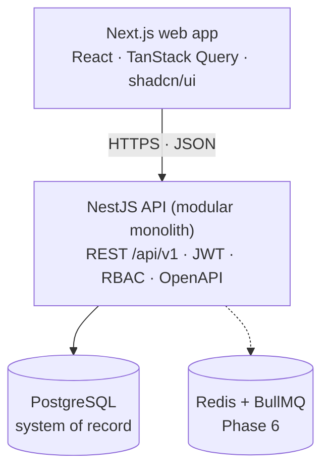

# NexusERP

> Hệ thống ERP modular-monolith cho doanh nghiệp vừa và nhỏ có nhiều chi nhánh: bán hàng, khách hàng, tồn kho, phân quyền và (về sau) mua hàng, tài chính, nhân sự.

[](https://github.com/5erax/nexuserp/actions/workflows/repo-checks.yml)
[](LICENSE)


**Trạng thái hiện tại:** đang triển khai Phase 1. Nền tảng và hợp đồng MVP đã có; API hỗ trợ login/me/refresh/logout, CSRF, rate limit, guard mặc định từ chối và audit append-only. Schema IAM và seed permission/role có kiểm thử PostgreSQL. Giao diện auth/quản trị và nghiệp vụ bán hàng/tồn kho còn trong backlog. Xem [hướng dẫn chạy](docs/development/SETUP.md); tiến độ theo dõi tại [GitHub Project](https://github.com/users/5erax/projects/5).

*English summary:* NexusERP is a portfolio-grade, multi-branch ERP (sales, inventory, IAM first) built as a modular monolith with NestJS, Next.js and PostgreSQL. The goal is to demonstrate correct business logic rather than CRUD screens: atomic stock reservation under concurrency, idempotent commands, an append-only inventory ledger, scoped RBAC and automated tests. Specs, business rules and ADRs live in [`docs/`](docs/README.md).

## Mục tiêu

NexusERP không nhằm làm ra thêm một bộ giao diện CRUD. Dự án phải chứng minh được năng lực thiết kế một hệ thống thực tế:

- Nghiệp vụ liên kết xuyên module (Order-to-Cash, Inventory Control).
- Dữ liệu nhất quán: transaction ngắn, ràng buộc ở database, sổ cái tồn kho append-only.
- Xử lý đồng thời: hai người cùng đặt món hàng cuối cùng thì chỉ một người thành công.
- Phân quyền theo vai trò **và** phạm vi (tổ chức, chi nhánh, bản ghi).
- Bảo mật, idempotency và kiểm thử tự động cho các quy tắc quan trọng.

## Phạm vi MVP (kết thúc Phase 4)

| Module | Nội dung |
| --- | --- |
| IAM & Organization | Đăng nhập, refresh token rotation, user, role, permission, chi nhánh, audit log |
| Catalog | Sản phẩm, biến thể (SKU) |
| Inventory | Kho, tồn đầu kỳ, stock ledger, đặt trước (reservation), điều chỉnh có phê duyệt |
| CRM | Khách hàng |
| Sales | Đơn hàng, xác nhận và giữ hàng, giao đủ một lần, hủy trước khi xuất kho |
| Finance (tối giản) | Ghi nhận thanh toán thủ công vào đơn từ Phase 3; chưa có hóa đơn, công nợ, hoàn tiền |
| Reporting | Dashboard doanh thu, đơn hàng, tồn kho; audit timeline; export |

Purchasing, chuyển kho, giao một phần, trả hàng, Finance đầy đủ, HRM và báo cáo lợi nhuận nằm ở Phase 5; cách ly tenant đầy đủ nằm ở Phase 6. Chi tiết trong [SCOPE](docs/product/SCOPE.md) và [roadmap](docs/roadmap/PHASE_PLAN.md).

## Kiến trúc



Mỗi business module (`iam`, `catalog`, `crm`, `sales`, `inventory`, ...) có lớp `presentation / application / domain / infrastructure` riêng, sở hữu quy tắc nghiệp vụ và các thao tác ghi của mình. Module khác không ghi trực tiếp vào bảng của module đó. Xem [ADR-0002](docs/adr/0002-modular-monolith.md).

## Tech stack

| Lớp | Công nghệ |
| --- | --- |
| Frontend | Next.js, React, TypeScript, Tailwind, shadcn/ui, TanStack Query, Zustand |
| Backend | NestJS, REST + OpenAPI, Prisma |
| Dữ liệu | PostgreSQL (nguồn sự thật), Redis + BullMQ (từ Phase 6) |
| Bảo mật | JWT, HttpOnly cookie, Argon2id, RBAC + branch scope |
| Kiểm thử | Vitest/Jest, Supertest, Playwright |
| Vận hành | Docker, GitHub Actions |

## Nguyên tắc kỹ thuật cốt lõi

- Controller không truy cập database; mỗi module sở hữu quy tắc và thao tác ghi của mình.
- `available = on_hand - reserved`, giữ hàng bằng `UPDATE` có điều kiện trong transaction ([ADR-0004](docs/adr/0004-inventory-ledger-and-atomic-balance.md)).
- Tiền lưu bằng `DECIMAL`, chứng từ đã posted là bất biến ([ADR-0007](docs/adr/0007-money-and-immutable-posted-documents.md)).
- Lệnh có tác dụng phụ (`confirm`, `post`, `approve`) hỗ trợ `Idempotency-Key`.
- Không gọi HTTP bên ngoài khi đang giữ transaction; dùng transactional outbox ([ADR-0008](docs/adr/0008-transactional-outbox.md)).
- Mọi quy tắc nghiệp vụ được thực thi ở backend và có kiểm thử tự động, không chỉ ẩn nút ở frontend.

## Bắt đầu nhanh

Yêu cầu Node 22.12+ trong nhánh 22, pnpm 10.32.1 và Docker Compose v2 (hoặc PostgreSQL 17 có sẵn). Sao chép ba file `.env.example` ở gốc, `apps/api`, `apps/web` sang `.env` cùng thư mục rồi chạy:

```sh
corepack enable
corepack prepare pnpm@10.32.1 --activate
pnpm install --frozen-lockfile
pnpm db:generate
docker compose up -d postgres
pnpm db:migrate
pnpm dev
```

Mở [http://localhost:3000](http://localhost:3000); trạng thái kết nối đọc từ API và PostgreSQL thật. Muốn chạy toàn bộ bằng Docker: `docker compose --profile app up --build -d`. Hướng dẫn Windows, test, production build và xử lý lỗi ở [SETUP](docs/development/SETUP.md), cấu hình ở [CONFIGURATION](docs/development/CONFIGURATION.md).

Các tài liệu sản phẩm:

1. Đọc [tài liệu đặc tả SRS](docs/product/SRS.md).
2. Xem [chỉ mục tài liệu](docs/README.md) và [các ADR](docs/adr/README.md).
3. Theo dõi tiến độ tại [GitHub Project](https://github.com/users/5erax/projects/5) hoặc [danh sách issue](https://github.com/5erax/nexuserp/issues).

Phiên bản Node.js được ghim trong [`.nvmrc`](.nvmrc).

## Roadmap

| Phase | Nội dung | Ước lượng |
| --- | --- | --- |
| 0 | Product và architecture foundation | 1–2 tuần |
| 1 | IAM và Organization | 2–3 tuần |
| 2 | Catalog và Inventory | 3–4 tuần |
| 3 | CRM core và Sales | 3–4 tuần |
| 4 | Reporting và portfolio MVP release | 2–3 tuần |
| 5 | Advanced business ERP (Purchasing, Finance, HRM) | 6–10 tuần |
| 6 | Hardening và SaaS preparation | 3–5 tuần |

Các mốc là ước lượng kế hoạch, không phải cam kết thời gian. Mốc quan trọng nhất là **hết Phase 4**.

## Đóng góp, bảo mật và giấy phép

- Quy trình làm việc, quy ước branch/commit/PR: [CONTRIBUTING.md](CONTRIBUTING.md).
- Báo cáo lỗ hổng bảo mật: [SECURITY.md](SECURITY.md).
- Quy tắc ứng xử: [CODE_OF_CONDUCT.md](CODE_OF_CONDUCT.md).
- Giấy phép: [MIT](LICENSE).
