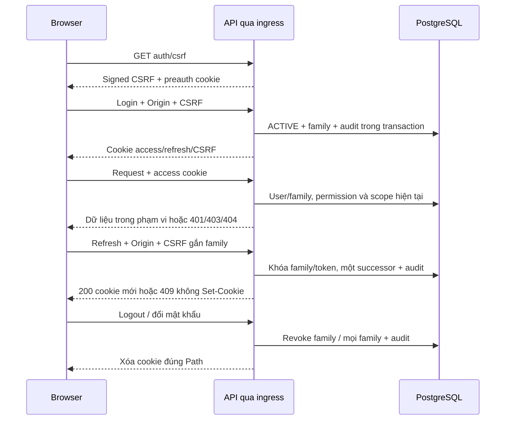

# Kiến trúc bảo mật

Nguồn quyết định: [ADR-0005](../adr/0005-rbac-with-resource-scope.md), [ADR-0006](../adr/0006-tenant-aware-single-tenant-mvp.md), [ADR-0010](../adr/0010-cookie-and-csrf-strategy.md). IAM server đã có test PostgreSQL; UI phiên #43 và nghiệp vụ tồn kho chưa được nghiệm thu bằng tài liệu này.

## Ranh giới và mô hình mối đe dọa rút gọn

Các đường dẫn mã dưới đây nằm trong `apps/api/src/`; test trong `apps/api/test/`.

| Luồng / STRIDE | Cách lạm dụng cần chặn | Biện pháp, mã và test thực tế |
| --- | --- | --- |
| Login / spoofing, information disclosure | Đoán user, brute force, lộ password | PasswordService: Argon2id, salt riêng, dummy hash; lỗi chung; SecurityGuard quota. Test security.spec.ts, auth.integration-spec.ts: sai/không tồn tại/inactive, cookie và 429 |
| Ingress / spoofing, denial of service | Giả X-Forwarded-For, flood JSON lỗi | common/security/client-address.ts chỉ tin một IP từ TCP peer cố định; configure-app.ts quota trước parser 1 MiB; Nginx ghi đè header. Test security.spec.ts, auth.integration-spec.ts malformed/oversize; infrastructure/docker/check-proxy.cjs chạy hai client trong CI |
| Refresh / tampering, replay | Hai tab, token cũ, mất response, prune race | AuthService khóa family rồi token, re-read sau khóa, một successor, 409 dưới 5s; replay revoke commit trước 401. Test auth.integration-spec.ts: barrier 200+409, 4.999/5.000s, T0 sau T1→T2, rollback, prune, logout/password race |
| Request / elevation of privilege | Route thiếu permission, role cũ, account disable | SecurityGuard deny default; quyền từ DB; IamAdminPolicy recheck sau khóa organization; UsersService revoke trước email/password update. Test auth.integration-spec.ts reflection/401/403; users.integration-spec.ts delegation, disable/reset tranh chấp refresh |
| Dữ liệu / information disclosure | IDOR, filter/count lộ chi nhánh khác | UsersService, OrganizationService, AuditService lọc organization/branch trước pagination; không xuất membership ngoài scope. Test users.integration-spec.ts: user/role/branch :id chéo scope/organization, filter, total, audit; check-scope-mutation.cjs bỏ filter phải làm test thất bại |
| Quản trị / tampering, elevation | Tự nâng quyền, vô hiệu admin cuối, sửa system role | Grant mới không vượt actor; bảo vệ target có quyền cao hơn; system role bất biến; org NO KEY UPDATE serialize admin count. Test users.integration-spec.ts: hai admin disable 200+409, gỡ role cuối, custom scope, nhiều role trùng grant |
| Audit / repudiation, information disclosure | Thiếu audit, sửa lịch sử, lộ secret | AuditService.record cùng transaction, redact đệ quy; DB trigger chặn UPDATE/DELETE; đọc cursor và scope. Test audit.integration-spec.ts, users.integration-spec.ts: fail rollback, redaction, cursor và branch scope |
| Tồn kho / tampering, denial of service | Overselling, movement trùng, sửa ledger | ADR-0004, transaction/idempotency là thiết kế; planned #46–54, #57; chưa triển khai/kiểm chứng ở Phase 1 |

## Phiên và CSRF

1. Browser lấy bootstrap CSRF qua `/api/v1/auth/csrf` cùng origin.
2. Login xác minh Origin, CSRF và mật khẩu Argon2id, tạo family hạn 7 ngày, đặt cookie access/refresh/CSRF theo ADR-0010.
3. Request được kiểm tra chữ ký JWT, user ACTIVE, family còn hiệu lực và quyền/scope hiện tại từ database. Request thay đổi dữ liệu còn phải kiểm tra CSRF/Origin.
4. Access hết hạn: một refresh tạo một successor, không kéo dài hạn family. Các trường hợp tranh chấp/replay theo [REFRESH_TOKEN_POLICY](REFRESH_TOKEN_POLICY.md).
5. Logout thu hồi family hiện tại; vô hiệu hóa user/reset password thu hồi mọi family của user. Thu hồi ở database chặn cả access JWT còn hạn.

Access JWT HS256: issuer `nexuserp`, audience `nexuserp-web`, hạn 15 phút. Refresh 32 byte ngẫu nhiên, DB chỉ giữ SHA-256, family hạn tuyệt đối 7 ngày. Cookie access HttpOnly Path=/api/v1; refresh HttpOnly Path=/api/v1/auth; CSRF đọc được Path=/. Tất cả SameSite=Lax, không Domain, Secure ở production. JSON không có access/refresh. Preauth HttpOnly hạn 10 phút. Mã: AuthService, AuthController và common/security/{cookies,csrf.service}.ts; test auth.integration-spec.ts và security.spec.ts.

Org/user dùng NO KEY UPDATE để không chặn KEY SHARE của audit FK khi chờ family; family/token vẫn FOR UPDATE. Thay email thu hồi/khóa family trước UPDATE unique có thể nâng khóa. Quyền hiện tại được đọc lại trong transaction quản trị. Test barrier dùng PostgreSQL thật, không dùng sleep để đoán race.

## Tham số và kiểm chứng

- Argon2id v19: memory 19,456 KiB, time 2, parallelism 1, output 32 byte; rehash sau login nếu yếu hơn. Đo smoke 10 hash độc lập ngày 15/10/2026, Windows x64, Node 22.23.3, i5-12500H: min 14 ms, median 17 ms, max 20 ms. Đây không phải benchmark tải hay cam kết latency production.
- API mặc định 300 request/IP/phút trước parser; login 10/IP/15 phút và 10/(organization,email)/15 phút; refresh và bootstrap CSRF mỗi loại 60/IP/phút. Counter tối đa 10,000 bucket; hết chỗ trả 429 có Retry-After. API_RATE_LIMIT cấu hình quota tổng; test biên và hai client thật trong CI; chưa load test.
- `pnpm --filter @nexus/api test:security` chạy auth/users trên database `_test`. `test:security:mutation` bỏ filter, xác nhận đúng assertion isolation thất bại rồi khôi phục byte gốc. CI job security lưu coverage/mutation log. Test integration đầy đủ còn kiểm chứng schema/FK và audit trigger. Truy vết: [IAM_RULES](../business-rules/IAM_RULES.md).
- Helmet/CSP, error envelope và requestId trước parser; ValidationPipe loại field lạ, giới hạn input, không echo password; log không có body/cookie/token. Test foundation.spec.ts và auth/users integration. DTO response chọn field tường minh, không serialize user record chứa hash.

## Giới hạn còn lại

- CSRF không chặn XSS hoặc token đang ACTIVE bị đánh cắp. Chưa có MFA, khôi phục qua email hoặc quản lý thiết bị phía UI.
- Một tổ chức ở MVP; khóa organization không tương đương cách ly tenant đầy đủ. Tenant isolation thuộc Phase 6.
- Chỉ dùng dữ liệu mẫu. Không log cookie, token, password hoặc hash; audit không lưu nguyên request chứa secret.
- Quota trong bộ nhớ một process; cần shared store trước khi tăng replica. Native Next rewrite chỉ dùng local; production cần ingress tin cậy, HTTPS/TLS và secret riêng theo CONFIGURATION. CI không chứng minh cấu hình tên miền production.
- Khóa organization serialize quản trị phù hợp MVP, chưa đo tải lớn. Audit append-only vẫn phụ thuộc quyền DB: chủ DB có thể đổi trigger; chưa có kho audit bên ngoài chống sửa bởi DBA.
- Backend IAM có test; UI phiên #43, Inventory/Sales và deployment demo chưa hoàn thành. Không coi các thiết kế planned là biện pháp đã hoạt động.
