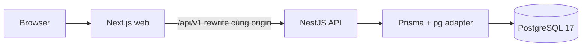

# Kiến trúc nền tảng đang chạy

Web dùng App Router, TanStack Query, shared UI tokens và client từ OpenAPI. NestJS đặt global prefix `/api/v1`, validation nghiêm ngặt, requestId, envelope, exception filter và log JSON đã giới hạn trường. IAM có auth cookie/CSRF, JWT kiểm tra family/user mỗi request và guard mặc định từ chối; mọi route phải có metadata công khai, session hoặc permission. Audit cùng transaction và trigger append-only. Đã có giao diện auth/quản trị/Catalog và Inventory ledger/reservation, đối soát, API kho/số dư/movement; phiếu điều chỉnh và Inventory Workbench đang tiếp tục triển khai.

Liveness `/health` không cần database. Readiness `/health/ready` chạy `SELECT 1` trên PostgreSQL qua HealthService và Prisma, trả 503 không lộ credential khi mất kết nối. API được phép khởi chạy khi database tạm hỏng, nhưng thiếu/sai cấu hình phải fail ngay.

OpenAPI sinh từ Nest decorators qua `pnpm contracts:generate`; `packages/contracts` giữ schema TypeScript sinh tự động và factory typed client. CI tái sinh rồi kiểm tra drift. Quy ước pagination/idempotency ở [API_CONVENTIONS](../api/API_CONVENTIONS.md). Framework trong common/idempotency dùng advisory transaction lock PostgreSQL; authorize chạy cả trước replay, rồi key/result và business write commit cùng transaction. Domain/application của module tiếp nhận transaction; presentation không truy cập database trực tiếp.

Docker dùng migration job riêng, API/web image chạy user không phải root, PostgreSQL volume bền vững. Redis/BullMQ, metrics và cách ly tenant đầy đủ chưa thuộc Phase 0.
