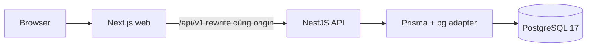

# Kiến trúc nền tảng đang chạy

Web dùng App Router, TanStack Query, shared UI tokens và client từ OpenAPI. NestJS đặt global prefix `/api/v1`, validation nghiêm ngặt, requestId, envelope, exception filter và log JSON đã giới hạn trường. Chưa có endpoint nghiệp vụ hoặc cơ chế xác thực.

Liveness `/health` không cần database. Readiness `/health/ready` chạy `SELECT 1` trên PostgreSQL qua HealthService và Prisma, trả 503 không lộ credential khi mất kết nối. API được phép khởi chạy khi database tạm hỏng, nhưng thiếu/sai cấu hình phải fail ngay.

OpenAPI sinh từ Nest decorators qua `pnpm contracts:generate`; `packages/contracts` giữ schema TypeScript sinh tự động và factory typed client. CI tái sinh rồi kiểm tra drift. Đây là nguồn contract máy đọc được hiện tại; quy ước pagination/idempotency cho endpoint nghiệp vụ còn ở #25/#47.

Docker dùng migration job riêng, API/web image chạy user không phải root, PostgreSQL volume bền vững. Redis/BullMQ, metrics và cách ly tenant đầy đủ chưa thuộc Phase 0.
