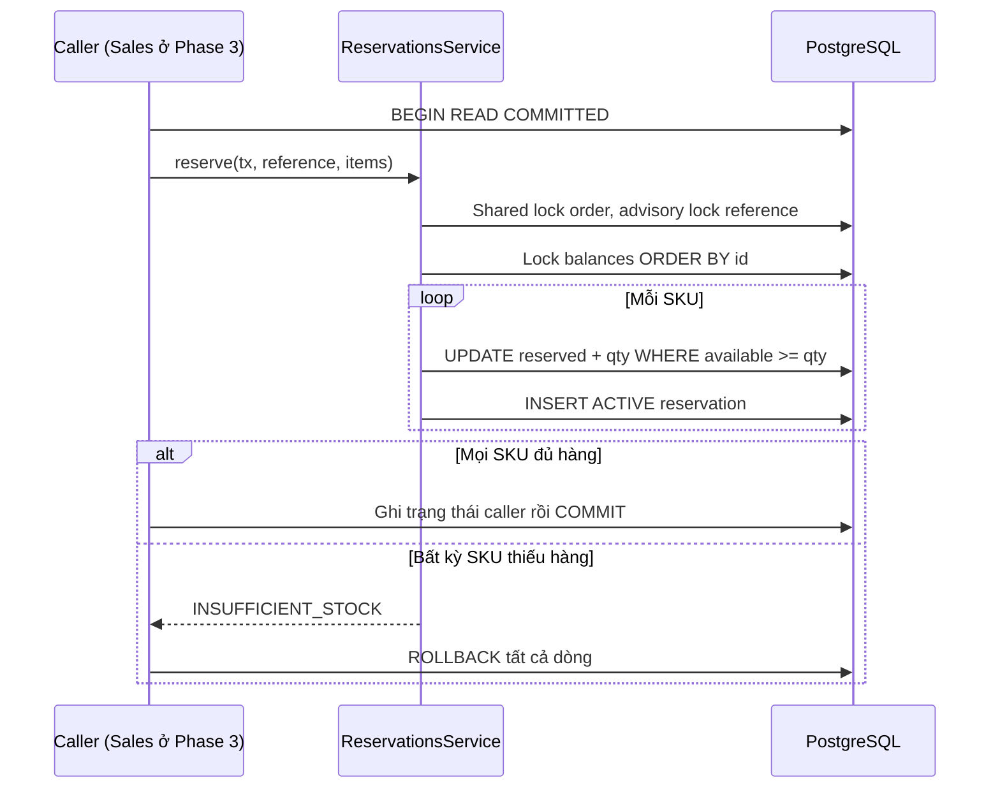
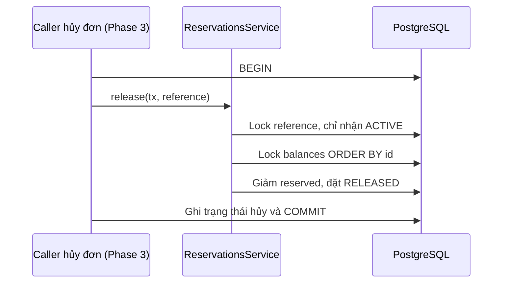
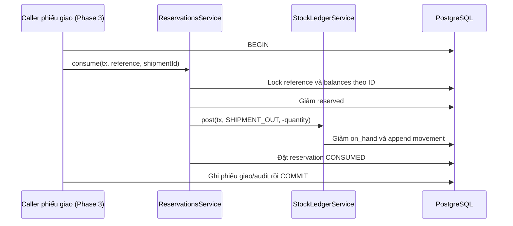
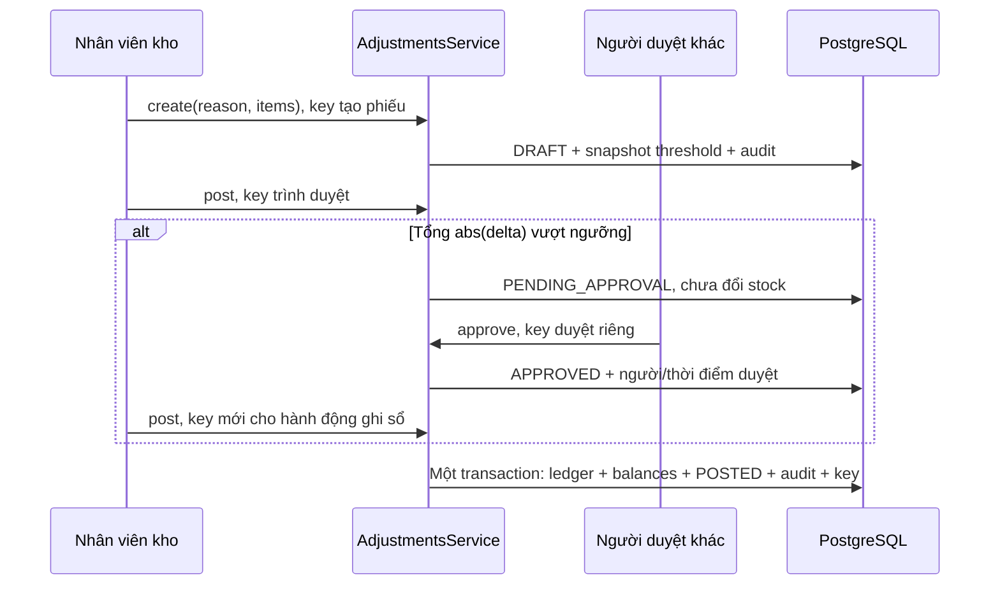

# Quy tắc Catalog & Inventory

Nguồn [SRS](../product/SRS.md), các ADR đã Accepted và [ma trận quyền](PERMISSION_MATRIX.md). Mỗi ID SRS chỉ xuất hiện một lần ở cột ID trong bộ tài liệu này. `planned:#issue` là kế hoạch kiểm thử, không phải đã triển khai.

| ID | Phát biểu | Phase | Nơi thực thi | Test tham chiếu | Trạng thái |
| --- | --- | --- | --- | --- | --- |
| INV-001 | SKU phải duy nhất trong một tổ chức | 2 | unique(organization_id,sku), normalize DTO, CHECK uppercase/trim | apps/api/test/inventory-schema.integration-spec.ts; apps/api/test/catalog.integration-spec.ts | Schema/API, gồm tranh chấp SKU, đã kiểm chứng |
| INV-002 | Không cho phép xuất hàng vượt tồn khả dụng | 2 | ledger/reservation atomic guarded balance update + CHECK | apps/api/test/stock-ledger.integration-spec.ts; apps/api/test/reservations.integration-spec.ts; apps/api/test/stock-concurrency.integration-spec.ts | Ledger/reservation và 20 vòng tranh chấp đã kiểm chứng |
| INV-003 | `available = on_hand - reserved` | 2 | available derived, conditional reserve, CHECK reserved<=on_hand | apps/api/test/inventory-schema.integration-spec.ts; apps/api/test/reservations.integration-spec.ts; apps/api/test/warehouses.integration-spec.ts | CHECK/Decimal, reservation và read API đã kiểm chứng |
| INV-004 | Mọi biến động tồn kho phải có stock movement | 2 | ledger append cùng transaction balance/document/audit/idempotency, rollback khi lỗi | apps/api/test/stock-ledger.integration-spec.ts; apps/api/test/adjustments.integration-spec.ts | Posting service và document API; CI là gate trước khi gộp |
| INV-005 | Không được xóa lịch sử xuất nhập kho đã posted | 2 | SQL trigger chặn UPDATE/DELETE movement/phiếu POSTED, chặn thêm/sửa/xóa/chuyển dòng đã POSTED | apps/api/test/inventory-schema.integration-spec.ts; apps/api/test/stock-ledger.integration-spec.ts; apps/api/test/adjustments.integration-spec.ts | Trigger cho ledger và chứng từ; CI là gate trước khi gộp |
| INV-006 | Chuyển kho phải bảo đảm xuất nguồn và nhập đích được hạch toán đúng trạng thái | 5 | transfer state + transaction nguồn/đích | planned:#7 | Sau MVP |
| INV-007 | Điều chỉnh tồn kho yêu cầu lý do; vượt ngưỡng phải được phê duyệt | 2 | CHECK reason/actor/timestamp; tổng abs delta vượt snapshot ngưỡng server, người khác duyệt | apps/api/test/inventory-schema.integration-spec.ts; apps/api/test/adjustments.integration-spec.ts | Policy và HTTP command; CI là gate trước khi gộp |
| INV-008 | Không cho phép sửa trực tiếp `on_hand` từ CRUD API | 2 | chỉ StockLedgerService ghi onHand, test cấu trúc chặn đường ghi khác | apps/api/test/stock-ownership.spec.ts; apps/api/test/catalog.integration-spec.ts | Ledger ownership đã kiểm chứng; Inventory không có CRUD số dư |
| INV-009 | Reservation phải được giải phóng khi hủy đơn hoặc hết hạn hợp lệ | 3 | Inventory release trong caller transaction, cancel Sales #64, expiry sau MVP | apps/api/test/reservations.integration-spec.ts; planned:#64 | Release/consume đã kiểm chứng; cancel đơn còn lại |
| INV-010 | Không được sửa SKU của sản phẩm đã có giao dịch nếu làm sai lịch sử | 2 | Catalog lock/check + trigger cấm đổi SKU đã có stock movement; FK RESTRICT | apps/api/test/inventory-schema.integration-spec.ts; apps/api/test/catalog.integration-spec.ts; apps/api/test/sales-schema.integration-spec.ts | API/DB bảo vệ stock và Sales history |

Quy tắc bổ sung: Inventory sở hữu warehouse, default warehouse duy nhất trong branch; unit_cost nullable nonnegative ở OPENING/ADJUSTMENT_IN (NULL khác 0). Post shipment giảm cả on_hand/reserved và tiêu thụ reservation. document_sequences do platform sở hữu để cấp số chứng từ trong transaction; UNIQUE là lớp bảo vệ cuối. Reconciliation so sánh sum movements với on_hand và sum ACTIVE reservations với reserved, không tự sửa ledger (#52).

Reservation dùng READ COMMITTED, khóa reference rồi khóa balance theo ID tăng dần và conditional UPDATE; không dựa vào số dư đọc trước đó. Mọi dòng giữ/giải phóng/tiêu thụ cùng transaction với caller. `withTransactionRetry` thử lại toàn bộ transaction tối đa ba lần chỉ khi database xác nhận deadlock/serialization abort; không retry timeout/mất kết nối hay lỗi nghiệp vụ. Chi tiết interface và bằng chứng kiểm thử ở [Inventory services](../development/INVENTORY.md).

Đối soát đã có API/CLI chỉ đọc: so sánh on_hand với tổng movement và reserved với tổng reservation ACTIVE trong cùng snapshot, kể cả thiếu balance hoặc thiếu ledger. API yêu cầu balances.read ORG, phân trang tối đa 100 và không nhận organizationId từ client. `apps/api/test/reconciliation.integration-spec.ts` kiểm chứng sai lệch, scope, Decimal, phân trang và exit code CLI. Quy trình điều tra/sửa có kiểm soát nằm trong hướng dẫn Inventory; không tự ghi đè số dư để làm báo cáo xanh.

## Thứ tự khóa và transaction

Caller mở một interactive transaction READ COMMITTED; Inventory không commit riêng. Reservation khóa shared order theo reference trước để giữ snapshot dòng đơn, rồi khóa advisory theo organization/reference, sau đó khóa các balance theo ID tăng dần (`FOR NO KEY UPDATE`). Conditional UPDATE vẫn kiểm tra available tại thời điểm ghi; đọc available trước đó chỉ để hiển thị. Hai người cùng tranh đơn vị cuối không thể cùng vượt điều kiện này. CHECK `0 <= reserved <= on_hand` là lớp bảo vệ cuối, không thay thế atomic guard. Test mutation cố bỏ guard và phải bị test tranh chấp phát hiện.

Adjustment khóa organization FOR SHARE để giữ ổn định quyền/branch access, rồi khóa phiếu FOR UPDATE và reauthorize phiên hiện tại. Ghi sổ giữ khóa shared warehouse/branch ACTIVE, khóa balance hiện có theo ID tăng dần, xử lý SKU chưa có balance theo thứ tự UUID. Ledger tạo balance bằng INSERT ON CONFLICT rồi UPDATE nguyên tử. Trigger dòng cũng khóa parent, nên sửa dòng trực tiếp không thể chen vào ghi sổ. Tất cả giữ khóa đến khi commit/rollback; không gọi dịch vụ mạng trong transaction.

`withTransactionRetry` thuộc caller, thử lại toàn bộ transaction tối đa 3 lần, nghỉ 10 rồi 20 ms khi PostgreSQL/Prisma xác nhận abort do deadlock/serialization. Hết lượt trả 409 TRANSACTION_CONFLICT; lỗi nghiệp vụ, timeout hoặc mất kết nối không bị tự retry. Với kết quả mạng chưa chắc chắn, client gửi lại cùng nội dung/key. Không retry riêng một UPDATE trong transaction đã abort.

Danh sách có count dùng REPEATABLE READ cho count/rows nhất quán trong từng request. Đối soát cũng dùng REPEATABLE READ, tránh so ledger và balance ở hai thời điểm khác nhau. Movement timeline chỉ một SELECT, cursor `(createdAt,id)` giảm dần, không dùng offset; scope/filter được áp lại mỗi request. Snapshot không giữ xuyên nhiều request.

## Luồng giữ hàng

## Luồng giải phóng

Release không đổi on_hand hay tạo movement vì chưa có xuất/nhập vật lý. Reference đã kết thúc không được tái dùng. Việc hủy đơn gọi release thuộc #64; chưa có job hết hạn reservation trong MVP. Không tự đánh dấu RELEASED để che lỗi khi thiếu reservation/balance mismatch.

## Luồng xuất kho

Giảm reserved trước khi giảm on_hand trong cùng transaction để giữ CHECK hợp lệ; bên ngoài chỉ thấy trạng thái sau commit. Bất kỳ lỗi nào rollback cả hai số dư, movement và reservation. Interface đã được test, endpoint nghiệp vụ giao hàng thuộc Phase 3; không gọi Inventory bằng API sửa balance.

## Luồng điều chỉnh có phê duyệt

Tổng abs(+8,-8) là 16, không phải 0; đúng bằng ngưỡng được post. Người tạo không tự approve dù là Owner. Người có quyền approve cùng scope có thể reject kèm lý do; người có quyền create cùng scope có thể cancel phiếu chưa posted. REJECTED/CANCELLED/POSTED là terminal. Không có sửa/xóa phiếu: hủy bản chưa posted và tạo lại. OPENING chỉ dành warehouse/SKU chưa có movement; unit_cost NULL nghĩa là chưa biết chi phí, khác chi phí 0.

## Runbook đối soát và điều tra

1. Dùng tài khoản có `inventory.balances.read` ORG gọi `GET /api/v1/inventory/reconciliation?page=1&pageSize=100`. Không truyền organizationId trong HTTP; server lấy từ phiên. Hoặc chạy `pnpm --filter @nexus/api inventory:reconcile <organization-UUID-v4> 1` với DATABASE_URL đã cấu hình riêng; không đưa URL/secret vào log hoặc ticket. CLI là công cụ quản trị tin cậy, phải được cấp đúng quyền truy cập DB.
2. Lấy đủ các trang dựa theo total; lọc warehouseId trên API nếu đang điều tra một kho. API/CLI chỉ đọc. Exit code CLI 0 = sạch, 2 = có sai lệch trong tổ chức, 1 = tham số/cấu hình/kết nối lỗi. Trang rỗng không chứng minh sạch nếu total vẫn khác 0. Mỗi trang là snapshot riêng; khi đang ghi nhiều, tạm dừng command ảnh hưởng và chạy lại toàn bộ để chốt phạm vi.
3. Giữ lại thời gian UTC, organization/kho/SKU, onHand/expectedOnHand, reserved/expectedReserved, missingBalance và requestId nếu có. Đối chiếu movement theo reference, phiếu, audit và ACTIVE reservation. Không đưa dữ liệu khách hàng/credential vào bằng chứng.
4. Ngừng ghi cho kho/SKU bị ảnh hưởng ở tầng vận hành trong lúc điều tra. Xác định lỗi atomic write, command cũ, script thủ công, cache thiếu row hay thiếu lịch sử; chạy lại đối soát sau khi có phạm vi ổn định. Thiếu balance, thiếu ledger hoặc reserved lệch không được tự sửa bằng UPDATE cho bằng nhau. Lập phương án sửa dữ liệu có backup, review, bằng chứng và kiểm tra hậu kỳ; không tắt trigger hay xóa ledger.
5. Phân biệt chênh kiểm kê vật lý với lỗi kỹ thuật đối soát: nếu sổ/balance khớp nhưng thực đếm khác, tạo ADJUSTMENT có lý do/chứng từ và delta đúng; trình người khác duyệt nếu vượt ngưỡng, sau đó ghi sổ. Nếu ledger và balance vốn đã lệch, thêm adjustment sẽ đổi cả hai cùng lượng và không chữa độ lệch đó; cần sửa nguyên nhân/kế hoạch phục hồi trước.
6. Xác nhận reserved không bị xuất nhầm, đối soát sạch sau xử lý và audit đầy đủ. Chạy bộ integration/concurrency/mutation liên quan trước khi mở lại ghi. Không chạy test trên dữ liệu ứng dụng/production: TEST_DATABASE_URL bắt buộc kết thúc `_test`, fixture chỉ dọn UUID test sở hữu.

## Runbook nhập tồn và sửa sai

- Chọn đúng kho/chi nhánh đang ACTIVE, SKU đã khai báo và đơn vị cơ sở; kiểm tra chưa có lịch sử trước OPENING. Phiếu tối đa 100 SKU, không trùng SKU, không delta 0 và không dùng float/scientific notation. Trên 100 chia nhiều phiếu; cùng warehouse/SKU không nhập opening lần hai.
- Tạo phiếu, kiểm tra lý do, dấu delta, quantity và chi phí. Post trả PENDING_APPROVAL chưa làm đổi số dư. Người khác đúng quyền/scope approve; staff post lại với key mới. Khi mất phản hồi, giữ nội dung và key của chính hành động đó để retry. Không cấp key mới chỉ để né conflict hoặc trạng thái terminal.
- Kiểm tra detail POSTED, movement có referenceId phiếu, số dư và audit; đối soát phải sạch. Sai phiếu đã posted xử lý bằng ADJUSTMENT mới có dấu/lý do phù hợp, giữ nguyên bản gốc; không xóa lịch sử. Hủy bản DRAFT/PENDING_APPROVAL/APPROVED khi cần sửa trước post.
- `INSUFFICIENT_STOCK` yêu cầu kiểm tra available và reservation; `SELF_APPROVAL_FORBIDDEN` yêu cầu người khác duyệt; `WAREHOUSE_INACTIVE` yêu cầu quản trị xử lý trạng thái rồi thử lại; `MOVEMENT_ALREADY_POSTED` cần kiểm tra lịch sử để tránh nhập tồn đầu kỳ lần nữa. Không nới constraint để hoàn tất một command lỗi.

Bằng chứng tự động: 20 vòng độc lập trong stock-concurrency.integration-spec.ts, 100 contender/SKU, nhiều SKU đảo thứ tự, reserve/release/consume và reconciliation; reservations.integration-spec.ts kiểm tra deadlock/serialization thực trên nhiều connection và giới hạn retry. stock mutation phải RED khi bỏ guard. Các test này chứng minh tính đúng trên dữ liệu thử nghiệm, không thay phép đo tải/p95 hoặc kiểm tra vận hành production ở Phase 4.
