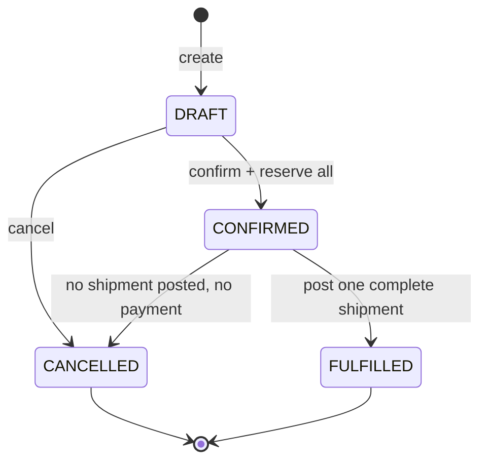

# Vòng đời đơn, giao hàng và thanh toán

## Đơn hàng MVP

Mọi command kiểm tra permission/scope theo [ma trận](PERMISSION_MATRIX.md), khóa order trước reservation/balance theo thứ tự warehouse/variant cố định và ghi audit + outbox cùng transaction. Body PATCH không nhận status, totals, giá client. `Idempotency-Key` bắt buộc với mọi POST nghiệp vụ dưới đây; replay cùng payload trả kết quả cũ.

| Từ | Action / endpoint suffix | Sang | Điều kiện và tác dụng phụ | Permission |
| --- | --- | --- | --- | --- |
| chưa tồn tại | POST /sales/orders | DRAFT | ≥1 dòng, quantity >0, customer và branch cùng tổ chức; snapshot warehouse mặc định ACTIVE cùng branch, giá/tên SKU; cấp số SO duy nhất | orders.create |
| DRAFT | PATCH /sales/orders/:id | DRAFT | Tính lại snapshot/tổng từ server; chưa có reservation hoặc payment | orders.update |
| DRAFT | POST /sales/orders/:id/confirm | CONFIRMED | Customer/warehouse/variant ACTIVE; reserve đủ mọi dòng; thiếu một SKU rollback toàn bộ | orders.confirm |
| DRAFT | POST /sales/orders/:id/cancel | CANCELLED | Chưa giao/nhận tiền; ghi lý do, không movement | orders.cancel |
| CONFIRMED | POST /sales/orders/:id/cancel | CANCELLED | Chưa shipment POSTED và chưa nhận tiền; release mọi reservation ACTIVE, giảm reserved, hủy shipment DRAFT | orders.cancel |
| CONFIRMED | POST /sales/orders/:id/shipments | CONFIRMED | Tạo một shipment DRAFT đủ các dòng còn lại; unique active shipment/order, không thay tồn | shipments.create |
| CONFIRMED | POST /sales/shipments/:id/post | FULFILLED | Shipment DRAFT đủ tất cả dòng; giảm on_hand và reserved cùng quantity, ACTIVE → CONSUMED, append movement SHIPMENT_OUT | shipments.post |

Tên permission orders/shipments ở bảng có prefix `sales.`. `orders.history` đọc sự kiện đã commit, không thay trạng thái. Payment không tự chuyển trạng thái đơn.

## Kết quả mọi cặp trạng thái/hành động

| State | PATCH | confirm | cancel | create shipment | post shipment | payment |
| --- | --- | --- | --- | --- | --- | --- |
| DRAFT | allow | allow nếu đủ hàng | allow | deny | deny | deny |
| CONFIRMED | deny | deny | allow nếu chưa giao/thu | allow nếu chưa có DRAFT | allow nếu DRAFT hợp lệ | allow |
| CANCELLED | deny | deny | deny | deny | deny | deny |
| FULFILLED | deny | deny | deny | deny | deny | allow |

`deny` →409 `INVALID_STATE_TRANSITION`; riêng đã thu tiền khi cancel →409 `ORDER_HAS_PAYMENTS`; thiếu hàng →409 `INSUFFICIENT_STOCK`; chưa có kho mặc định →409 `BRANCH_WAREHOUSE_NOT_CONFIGURED`; shipment trùng →409 `SHIPMENT_ALREADY_EXISTS`. Kiểm tra permission/scope trước trạng thái để tránh lộ bản ghi. Cùng Idempotency-Key thành công là replay trước kiểm tra transition; key mới không làm lại movement.

## Hai chiều trạng thái độc lập

- Shipment: DRAFT → POSTED hoặc CANCELLED; POSTED bất biến. Cancel order tự hủy DRAFT; post chỉ một lần; không giao từng phần MVP.
- Payment: không có trạng thái do người dùng sửa. Từng payment là khoản đã nhận bất biến; tổng=0 → UNPAID, 0<tổng<grandTotal → PARTIAL, tổng=grandTotal → PAID. Đơn tổng=0 coi PAID, không cho tạo payment amount=0. Tổng không được vượt grandTotal; chuyển khoản cần externalReference duy nhất. Xem ADR-0014.
- Adjustment: DRAFT → APPROVED → POSTED khi vượt ngưỡng; dưới/ngang ngưỡng DRAFT → POSTED. Có thể CANCELLED từ DRAFT/APPROVED; sửa DRAFT, đổi dữ liệu APPROVED phải về DRAFT; POSTED bất biến. Không tự phê duyệt.

## Sau MVP và test

PARTIALLY_FULFILLED, CLOSED, RETURN_PROCESS chỉ thiết kế Phase 5: return là chứng từ đảo/hoàn riêng, không sửa shipment/movement/payment gốc. Không đưa trạng thái này vào DTO MVP.

Test table-driven #60 bao phủ toàn bộ 24 ô của bảng; thêm totals=0, từng guard thất bại, cancel sau nhận tiền, cancel đua ship/pay, reserve đa SKU rollback, confirm đồng thời và replay cùng/khác key. Kiểm chứng SQL không còn reservation ACTIVE sau cancel/ship, movement chỉ sinh một lần và outbox chỉ chứa transition đã commit (#62–65, #70).
