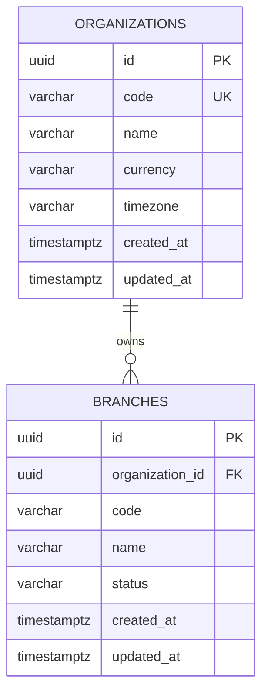

# ERD triển khai — baseline Phase 0

Schema này khớp migration hiện có. #19 còn phải mở rộng ERD/data dictionary cho IAM, Inventory, Sales và Finance tối giản trước schema tương ứng; sơ đồ trong SRS là mô hình đích, không phải bảng đã triển khai.
