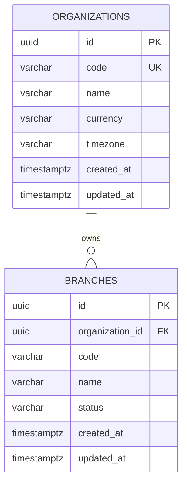
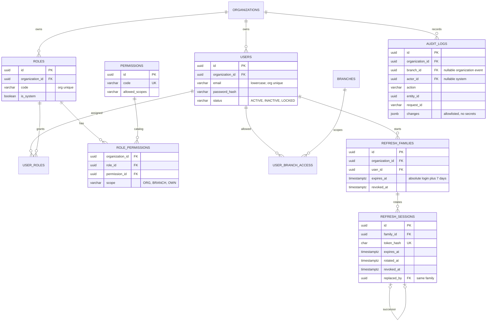
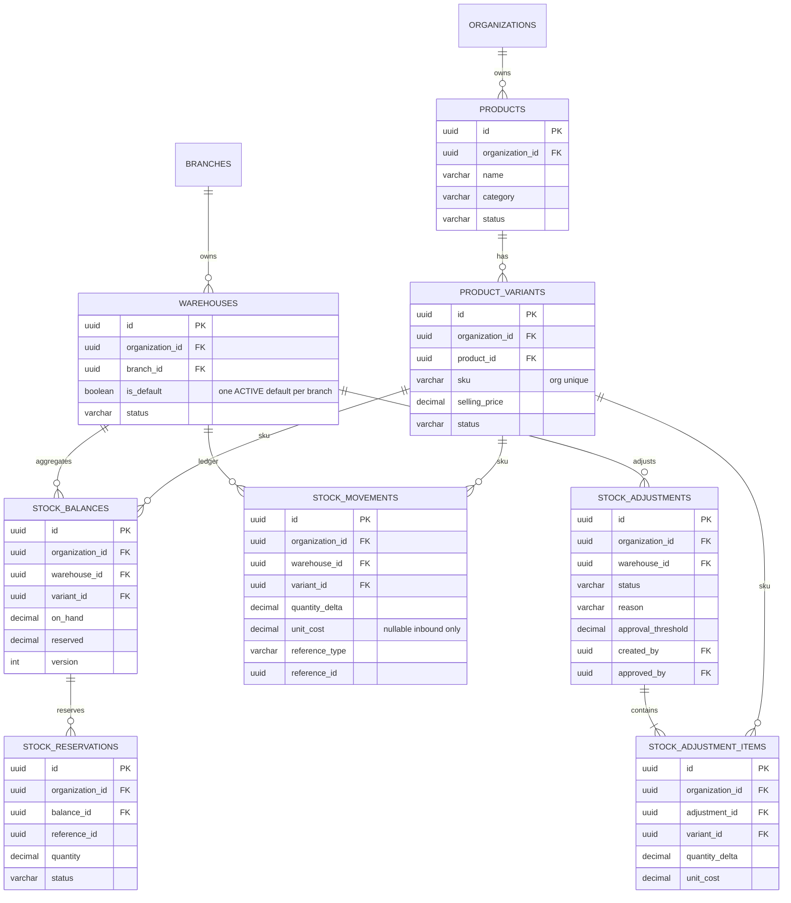
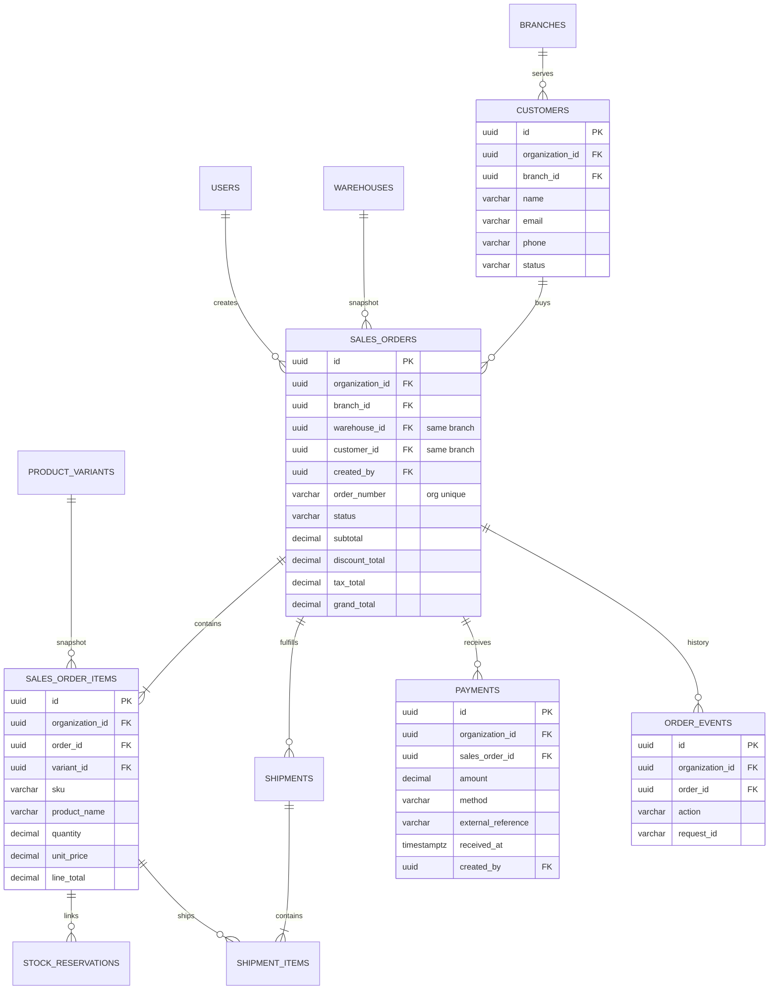
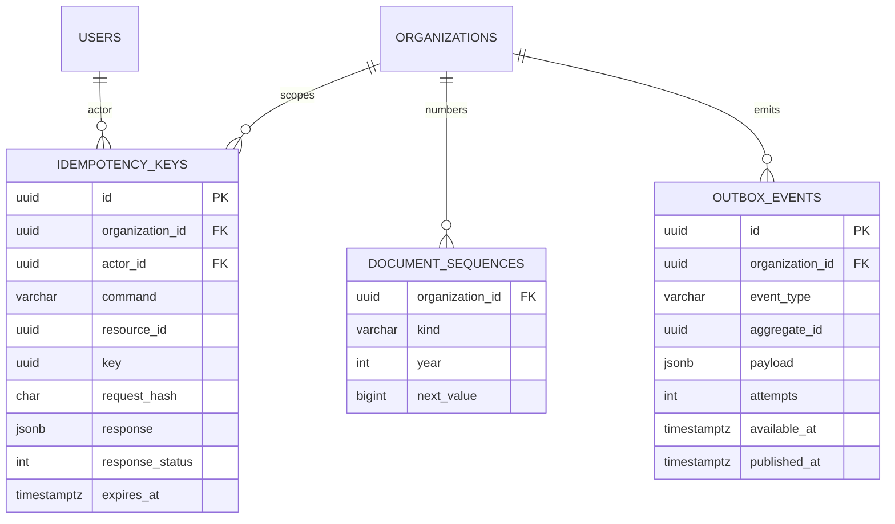
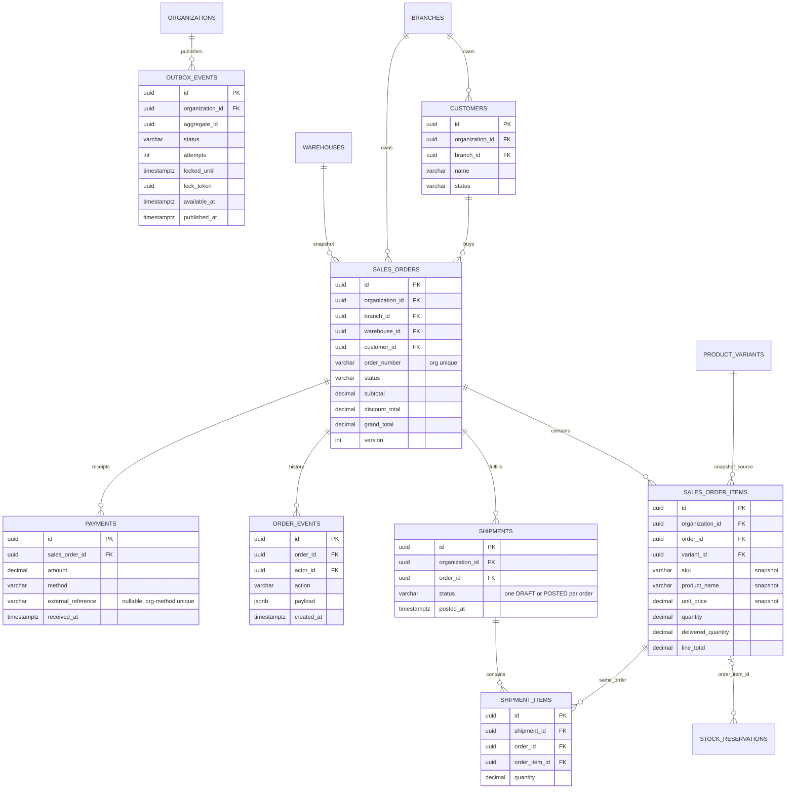

# ERD triển khai — Phase 0–4

Sơ đồ organization/branch khớp migration Phase 0. Các sơ đồ sau là **thiết kế đích**, chỉ trở thành bảng đã triển khai khi migration của phase tương ứng được gộp. Cột, unique/CHECK và index xem [DATA_DICTIONARY](DATA_DICTIONARY.md). Mọi quan hệ giữa entity thuộc tổ chức dùng khóa ghép organization, ON DELETE RESTRICT trừ bảng liên kết có ghi ngoại lệ.

## IAM và Audit — Phase 1

## Catalog và Inventory — Phase 2

Migration Phase 2 ban đầu chưa có order_item_id/FK. Migration Phase 3 20261016040000_crm_sales thêm nullable order_item_id, composite FK cùng organization và CHECK ACTIVE bắt buộc có liên kết sau preflight; lịch sử RELEASED/CONSUMED cũ được giữ. Xem [kế hoạch migration](RESERVATION_MIGRATION_PLAN.md).

## CRM, Sales và Finance tối giản — Phase 3

Shipment DRAFT/POSTED/CANCELLED; payment là receipt posted bất biến, không có provider status. Payment/order/warehouse/customer chống tham chiếu khác organization/branch bằng FK ghép. Invoice, allocation, refund, transfer, supplier, PO, goods receipt, journal, HR là **dự kiến Phase 5**, không tạo trong migration MVP.

## Nền tảng và Reporting

Reporting Phase 4 đọc aggregate qua interface module và filter scope trước SUM/COUNT; chưa cần bảng materialized/copy dữ liệu. Outbox dispatcher SKIP LOCKED, retry bounded, event id làm idempotency ở consumer. Không coi delivery là exactly-once.

## CRM, Sales, Finance và outbox — schema Phase 3

Mọi FK nghiệp vụ ghép organization; warehouse/customer của order còn ghép branch, shipment item ghép order để không gắn dòng của đơn khác. Reservation ACTIVE phải có order_item_id; lịch sử terminal Phase 2 có thể NULL. Header order và dòng snapshot bất biến sau confirm, trừ delivered_quantity được tăng khi CONFIRMED; order terminal, shipment committed, payment và order event được trigger bảo vệ. Tổng tiền/giá VND là Numeric(20,0), quantity Numeric(18,3); application vẫn phải kiểm tra tổng liên bảng, scope và trạng thái nghiệp vụ. Lease outbox phục vụ dispatcher #67 sau commit; schema không tự phát sự kiện hoặc gửi thông báo.
