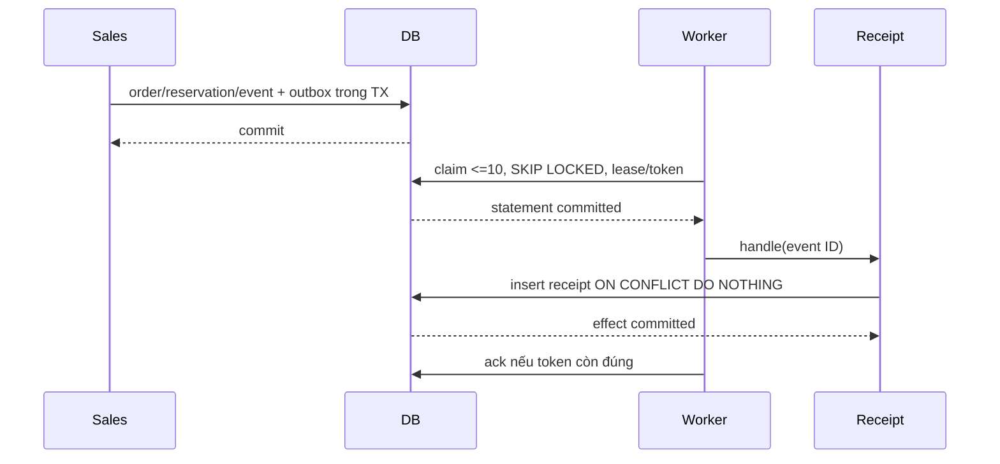

# Transactional outbox — MVP

Outbox là module kỹ thuật: producer gọi public `OutboxService.add(tx, event)` trong transaction nghiệp vụ, không gửi thông báo hoặc gọi handler từ transaction đó. Event gồm organizationId, eventType, aggregateId UUID và payload object tối đa 8 KiB khi JSON-serialize; database còn bảo vệ giới hạn jsonb 16 KiB. Payload tiền/số lượng dùng chuỗi như API; producer chỉ chọn các trường cần thiết, không đưa token, cookie hoặc secret. Rollback lệnh đồng nghĩa rollback event.

## Dispatcher và hiệu ứng đầu tiên

Dispatcher khởi động cùng API ở development/production, poll mỗi giây, không chồng lượt trong một instance. App test không auto poll; test gọi dispatchOnce trực tiếp. Shutdown hooks dừng timer và đợi lượt đang chạy. Mỗi lần claim tối đa 10 event đến hạn bằng CTE MATERIALIZED và FOR UPDATE SKIP LOCKED, commit statement trước khi gọi handler.

Event PROCESSING có lease 60 giây và UUID lock token. Ack/retry chỉ cập nhật row còn đúng token để worker cũ không ghi đè worker đã lấy lease mới. Lease hết hạn được claim lại; attempts tăng khi bắt đầu lần xử lý. Retry có backoff 1/2/4/8 giây, tối đa 5 lần. Handler không đăng ký hoặc lỗi liên tục chuyển DEAD; lease của lần cuối hết hạn cũng chuyển DEAD, không kẹt PROCESSING. PUBLISHED có publishedAt và không còn lease; DEAD không được tự xử lý lại.

Handler đăng ký qua OUTBOX_HANDLERS, eventType trùng làm startup thất bại. Consumer đầu tiên nhận `sales.order_confirmed` và ghi projection kỹ thuật append-only `outbox_receipts`: event ID, tổ chức, loại sự kiện, aggregate ID và thời điểm xử lý. Receipt có unique event ID, insert ON CONFLICT DO NOTHING; FK ghép giữ cùng tổ chức. Đây là log giao nhận bền vững để chứng minh dispatcher, không phải gửi email hoặc tự đổi trạng thái Sales.

Hệ thống giao ít nhất một lần: sau crash/lease hết hạn, handler có thể được gọi lại. Receipt là hiệu ứng idempotent nên mỗi event chỉ tạo đúng một row, kể cả khi crash xảy ra sau insert nhưng trước ack. Không tuyên bố exactly-once cho HTTP/email hoặc consumer tương lai; mọi consumer mới phải có dedup/effect cùng transaction của chính nó. Lease cố định phù hợp consumer receipt ngắn hiện tại; phải bổ sung gia hạn lease trước khi đăng ký handler chậm.



## Vận hành

Log lỗi chỉ có mã lỗi, event ID/type và attempts; không log payload hoặc exception thô từ database/handler. Mã chính: OUTBOX_POLL_FAILED, OUTBOX_HANDLER_FAILED, OUTBOX_HANDLER_NOT_REGISTERED, OUTBOX_ATTEMPTS_EXHAUSTED. Kiểm tra worker/API và database khi poll lỗi; xem event metadata theo tổ chức trước khi điều tra lỗi consumer.

```sql
SELECT id, event_type, aggregate_id, status, attempts, available_at,
       locked_until, published_at, last_error
FROM outbox_events
WHERE organization_id = :'organization_id'::uuid
ORDER BY created_at DESC, id DESC
LIMIT 100;
```

Redrive DEAD chỉ sau khi đã sửa nguyên nhân và xác nhận handler idempotent. Giữ nguyên event ID, tổ chức, aggregate, loại và payload; không clone thành ID mới để vượt dedup. Operator có quyền database dùng tham số UUID cụ thể, thao tác có review:

```sql
BEGIN;
UPDATE outbox_events
SET status = 'PENDING', attempts = 0, available_at = clock_timestamp(),
    locked_until = NULL, lock_token = NULL, last_error = NULL
WHERE organization_id = :'organization_id'::uuid
  AND id = :'event_id'::uuid AND status = 'DEAD';
COMMIT;
```

Không có endpoint công khai cho claim/ack/redrive. Không xóa/sửa receipt để xử lý lại; receipt và event liên quan được giữ để truy vết. Retention và consumer ngoài tiến trình thuộc thiết kế sau MVP.

## Migration và kiểm chứng

Migration 20261016050000_outbox_receipts chỉ thêm receipt, index unique và FK/trigger, không sửa event cũ. Index mới lấy write lock khi tạo: triển khai migration trước producer/worker mới, giữ dữ liệu khi rollback code và sửa schema bằng roll-forward. Không sửa migration đã áp dụng.

Unit kiểm tra caller transaction, input bound, duplicate registration, error log an toàn và startup/shutdown. PostgreSQL test bao phủ visibility trước commit/rollback, claim 10 và hai dispatcher, retry/due time/dead-letter, crash sau effect trước ack, lease cuối hết hạn, stale worker, receipt immutable và FK tổ chức.

Vì worker quét toàn queue, `outbox.integration-spec.ts` tạo database UUID riêng từ đầu, áp tất cả migrations và xác minh current_database trước khi dispatch. URL nguồn bắt buộc kết thúc `_test`; role test cần CREATEDB. Dùng role test riêng, không tăng quyền role ứng dụng production. Cleanup chỉ DROP database UUID do suite vừa tạo sau khi đóng connection, không FORCE hoặc reset database nguồn. Pipeline PostgreSQL đã có role phù hợp; chạy `pnpm --filter @nexus/api test:integration:foundation` như các suite khác.

Producer confirm đơn được nối ở #62; riêng dispatcher không có nghĩa toàn bộ luồng Order-to-Cash đã hoàn thành.
