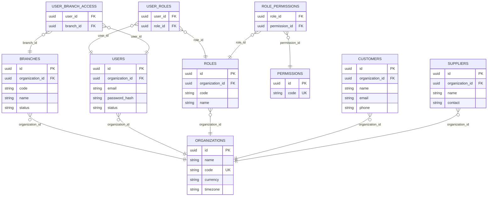
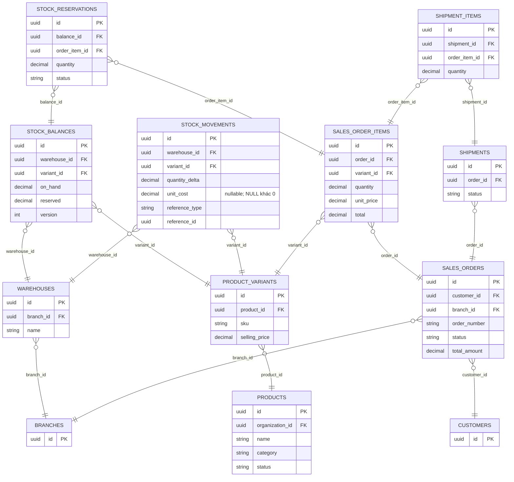
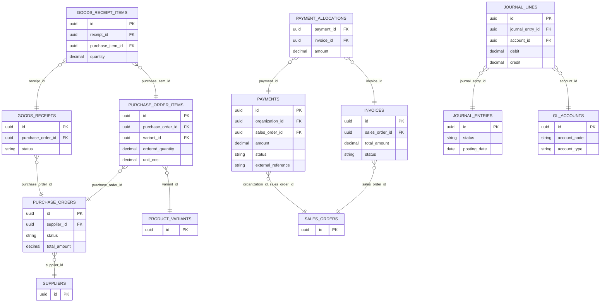

# NexusERP — Software Requirements Specification

**Software Requirements Specification & Technical Architecture** · Phiên bản 1.0 (baseline)

`Business ERP` · `Portfolio-ready` · `Modular Monolith` · `Web Application`

> Baseline gốc đã được làm sạch định dạng và hiệu chỉnh phạm vi theo roadmap Phase 0–6. Phụ lục A ghi trạng thái các điểm đã làm rõ và các phần còn phải triển khai; quyết định kiến trúc nằm trong ADR.

NexusERP là hệ thống quản trị nguồn lực doanh nghiệp (Enterprise Resource Planning), tập trung vào bán hàng, khách hàng, mua hàng, tồn kho, tài chính và nhân sự, dành cho doanh nghiệp vừa và nhỏ có nhiều chi nhánh.

Mục tiêu của dự án không chỉ là xây được giao diện đẹp. NexusERP phải chứng minh được năng lực thiết kế một hệ thống thực tế với nghiệp vụ liên kết, dữ liệu nhất quán, phân quyền, xử lý đồng thời, bảo mật và kiểm thử tự động.

## I. Tổng quan sản phẩm

| Hạng mục | Giá trị |
| --- | --- |
| Kiến trúc | Modular Monolith |
| Khách hàng mục tiêu | SME / Multi-branch |
| Nền tảng | Web Desktop + Responsive |
| Cơ sở dữ liệu | PostgreSQL |
| MVP | Sales + Inventory + IAM |
| Định hướng | SaaS-ready, single-tenant MVP |

### Personas và người dùng

| Vai trò              | Nhu cầu chính                                        |
| -------------------- | ---------------------------------------------------- |
| Business Owner       | Theo dõi sức khỏe doanh nghiệp, doanh thu, lợi nhuận |
| Branch Manager       | Quản lý chi nhánh, nhân viên, đơn hàng               |
| Sales Staff          | Tạo báo giá, bán hàng, theo dõi khách                |
| Warehouse Staff      | Nhập xuất kho, kiểm kê, chuyển kho                   |
| Purchasing Staff     | Đặt mua và nhận hàng từ nhà cung cấp                 |
| Accountant           | Theo dõi công nợ, thanh toán, đối soát               |
| HR Manager           | Quản lý nhân viên và chấm công                       |
| System Administrator | Tài khoản, cấu hình, phân quyền, audit               |

### Ranh giới dự án

Phiên bản portfolio đầu tiên dùng một doanh nghiệp có nhiều chi nhánh. Dữ liệu có cấu trúc `organization_id` ngay từ đầu để chuẩn bị cho multi-tenancy về sau, nhưng không tuyên bố là đã có cách ly tenant hoàn chỉnh.

Đơn vị tiền tệ mặc định là VND; ứng dụng dùng tiếng Việt trước, chuẩn bị cấu trúc để hỗ trợ tiếng Anh. Các nghiệp vụ kế toán pháp định, hóa đơn điện tử và tính lương theo quy định Việt Nam sẽ là phạm vi tích hợp/mở rộng, không giả định một mô hình đơn giản là đã đáp ứng pháp luật.

## II. Kiến trúc hệ thống

| Tầng | Thành phần |
| --- | --- |
| Presentation | Next.js · React · TanStack Query · shadcn/ui |
| API & Security | NestJS REST · JWT · RBAC · DTO Validation · Rate Limit |
| Domain & Application | IAM · Catalog · CRM · Sales · Inventory · Purchasing · Finance · HRM · Reporting · Audit |
| Dữ liệu | PostgreSQL (system of record); Redis/BullMQ từ Phase 6; attachments chưa thuộc MVP |

Các module có service và repository riêng, giao tiếp qua application interfaces/domain events.

### Tech Stack chuẩn

| Layer        | Công nghệ                          | Trách nhiệm                      |
| ------------ | ---------------------------------- | -------------------------------- |
| Frontend     | Next.js, TypeScript                | UI, routing, SSR khi cần         |
| UI System    | Tailwind, shadcn/ui                | Design tokens, components        |
| Client State | TanStack Query + Zustand           | Server state / UI state          |
| Backend      | NestJS                             | Modules, DI, business services   |
| API          | REST + OpenAPI                     | Contracts, tài liệu API          |
| Database     | PostgreSQL                         | Dữ liệu nghiệp vụ chuẩn          |
| Data Access  | Prisma                             | Schema, migrations, truy vấn     |
| Cache & Jobs | Redis, BullMQ (Phase 6)            | MVP dùng outbox polling trong tiến trình |
| Auth         | JWT, HttpOnly cookies, Argon2id    | Phiên đăng nhập, mã hóa mật khẩu |
| Testing      | Vitest/Jest, Supertest, Playwright | Unit, integration, E2E           |
| Ops          | Docker, GitHub Actions             | Build, test, triển khai          |

NestJS hỗ trợ module encapsulation, authorization, validation và API versioning, phù hợp với cách chia này.

**Nguyên tắc kiến trúc bắt buộc:**

- Controller không trực tiếp thao tác database.
- Mỗi module sở hữu business rules và write operations của mình.
- Module khác không tự ý cập nhật bảng nghiệp vụ thuộc module đó.
- Transaction ngắn, bao gồm toàn bộ thao tác dữ liệu phải thành công cùng nhau.
- Không thực hiện gọi HTTP bên ngoài khi đang giữ database transaction.
- Dùng outbox event cho các tác vụ cần xử lý đáng tin cậy sau commit.
- Không dùng cache làm nguồn sự thật cho tồn kho, thanh toán hay công nợ.

### Cấu trúc Monorepo

```
nexuserp/
├── apps/
│   ├── web/                # Next.js frontend
│   └── api/                # NestJS backend
├── packages/
│   ├── ui/                 # Shared UI components
│   ├── contracts/          # OpenAPI-generated clients
│   ├── config/             # ESLint, TSConfig
│   └── shared/             # Pure shared utilities
├── infrastructure/
│   ├── docker/
│   └── monitoring/
├── docs/
│   ├── architecture/
│   ├── business-rules/
│   ├── api/
│   ├── database/
│   ├── adr/
│   └── testing/
├── .github/workflows/
├── docker-compose.yml
└── README.md
```

Trong Backend, mỗi business module có:

```
modules/sales/
├── presentation/
│   ├── sales.controller.ts
│   └── dto/
├── application/
│   ├── commands/
│   ├── queries/
│   └── sales.service.ts
├── domain/
│   ├── entities/
│   ├── events/
│   └── policies/
├── infrastructure/
│   └── repositories/
└── sales.module.ts
```

Về lâu dài có thể tách một số module thành service độc lập, nhưng MVP không cần Microservices.

## III. Thiết kế chức năng theo module

NexusERP có **10 business module** dùng chung PostgreSQL, mỗi module sở hữu quy tắc và thao tác ghi của mình. Outbox là hạ tầng dùng chung, không phải module nghiệp vụ thứ 11.

| Module (mã chuẩn) | Trong MVP, kết thúc Phase 4 | Sau MVP |
| --- | --- | --- |
| IAM & Organization (`iam`) | Phase 1: phiên, users, roles, permissions, branches | Phase 6: cách ly tenant đầy đủ |
| Catalog (`catalog`) | Phase 2: products, variants, SKU, giá bán cơ bản | Phase 5: price list nếu cần |
| Inventory (`inventory`) | Phase 2: kho, ledger, balance, reservation, adjustment | Phase 5: chuyển kho và trả hàng |
| CRM (`crm`) | Phase 3: hồ sơ khách hàng, lịch sử đơn theo phạm vi | Leads/pipeline chỉ mở rộng khi có yêu cầu |
| Sales (`sales`) | Phase 3: đơn nháp, confirm, giao đủ một lần, hủy trước xuất kho | Phase 5: giao một phần, trả hàng, báo giá nếu cần |
| Finance (`finance`) | Phase 3: chỉ ghi nhận thanh toán thủ công vào đơn | Phase 5: hóa đơn, công nợ, phân bổ, sổ cái, hoàn tiền |
| Reporting (`reporting`) | Phase 4: doanh thu, đơn hàng, tồn kho, CSV | Phase 5: lợi nhuận sau khi có costing |
| Audit (`audit`) | Phase 1: nhật ký và API; Phase 4: giao diện timeline | Mở rộng theo nghiệp vụ |
| Purchasing (`purchasing`) | Không thuộc MVP | Phase 5: supplier, PO, nhận hàng, trả hàng mua |
| HRM (`hrm`) | Không thuộc MVP | Phase 5: nhân viên, chấm công, nghỉ phép |

Các luồng dưới đây mô tả đích dài hạn. MVP O2C chỉ gồm **khách hàng → đơn bán → giữ hàng → xuất kho/giao đủ → ghi nhận thanh toán thủ công**; không bao gồm báo giá, hóa đơn, đối soát công nợ hay pipeline CRM. API và UI bên dưới phải tuân theo phạm vi này.

### Luồng nghiệp vụ xuyên module

**Order-to-Cash (O2C)**

Khách hàng → Báo giá → Đơn bán → Giữ hàng → Xuất kho → Giao hàng → Hóa đơn/Chứng từ → Thanh toán → Đối soát

**Procure-to-Pay (P2P)**

Yêu cầu mua → Phê duyệt → Purchase Order → Nhận hàng → Nhập kho → Công nợ nhà cung cấp → Thanh toán

**Inventory Control**

Stock Ledger → Đặt trước → Xuất/Nhập → Chuyển kho → Kiểm kê → Điều chỉnh có phê duyệt

**People Operations**

Nhân viên → Phòng ban → Chấm công → Nghỉ phép → Tổng hợp dữ liệu lương

Các luồng này phải sử dụng trạng thái có định nghĩa, chứ không được cho nhân viên tự ý sửa mọi trạng thái đơn hàng hoặc phiếu kho.

## IV. Business Rules — Quy tắc nghiệp vụ

Đây là phần quan trọng nhất của dự án. Những quy tắc dưới đây phải được thực thi ở Backend và kiểm thử tự động, không chỉ disable nút ở Frontend.

### 1. Identity & Access Management

| ID      | Quy tắc                                                                            |
| ------- | ---------------------------------------------------------------------------------- |
| IAM-001 | Email đăng nhập phải duy nhất trong phạm vi tổ chức theo chính sách xác định trước |
| IAM-002 | Chỉ tài khoản ACTIVE mới được thực hiện nghiệp vụ                                  |
| IAM-003 | Mọi thao tác nghiệp vụ phải được kiểm tra permission tại Backend                   |
| IAM-004 | Nhân viên chỉ được truy cập chi nhánh được cấp quyền                               |
| IAM-005 | Hành động đặc quyền phải có audit trail                                            |
| IAM-006 | Không được vô hiệu hóa quản trị viên hoạt động cuối cùng của tổ chức               |
| IAM-007 | Refresh token phải hỗ trợ rotation và revocation                                   |

Cookie/CSRF theo [ADR-0010](../adr/0010-cookie-and-csrf-strategy.md). Rotation nguyên tử theo family; token đã xoay trong cửa sổ 5 giây, nếu successor vẫn hiện tại, chỉ nhận 409, không cấp token và không đổi cookie. Ngoài cửa sổ hoặc successor cũng đã xoay thì thu hồi family. Xem [bảng trạng thái và test bắt buộc](../architecture/REFRESH_TOKEN_POLICY.md).

RBAC dùng role để gán tập quyền, nhưng RBAC chưa đủ: cần thêm kiểm tra scope theo organization, branch và ownership của từng bản ghi.

Ví dụ `sales.orders.read` không đồng nghĩa với quyền xem mọi đơn hàng trên toàn doanh nghiệp.

### 2. Catalog & Inventory

| ID      | Quy tắc                                                                        |
| ------- | ------------------------------------------------------------------------------ |
| INV-001 | SKU phải duy nhất trong một tổ chức                                            |
| INV-002 | Không cho phép xuất hàng vượt tồn khả dụng                                     |
| INV-003 | `available = on_hand - reserved`                                               |
| INV-004 | Mọi biến động tồn kho phải có stock movement                                   |
| INV-005 | Không được xóa lịch sử xuất nhập kho đã posted                                 |
| INV-006 | Chuyển kho phải bảo đảm xuất nguồn và nhập đích được hạch toán đúng trạng thái |
| INV-007 | Điều chỉnh tồn kho yêu cầu lý do; vượt ngưỡng phải được phê duyệt              |
| INV-008 | Không cho phép sửa trực tiếp `on_hand` từ CRUD API                             |
| INV-009 | Reservation phải được giải phóng khi hủy đơn hoặc hết hạn hợp lệ               |
| INV-010 | Không được sửa SKU của sản phẩm đã có giao dịch nếu làm sai lịch sử            |

**Ví dụ kiểm tra tồn kho** (số liệu minh họa)

| Tồn vật lý (`on_hand`) | Đã giữ (`reserved`) | Muốn đặt | Khả dụng (`available`) | Kết quả |
| ---: | ---: | ---: | ---: | --- |
| 20 | 3 | 5 | 17 | Đủ hàng |

Minh họa quy tắc tính toán; thao tác đặt trước thực tế phải được kiểm tra nguyên tử trong database transaction.

### 3. Sales

| ID      | Quy tắc                                                                      |
| ------- | ---------------------------------------------------------------------------- |
| SAL-001 | Đơn hàng phải có tối thiểu một dòng sản phẩm hợp lệ                          |
| SAL-002 | Số lượng phải dương; giá tiền không âm                                       |
| SAL-003 | Giá bán và tên sản phẩm được snapshot vào order item                         |
| SAL-004 | Tổng giảm giá không được vượt giá trị hàng hóa đủ điều kiện                  |
| SAL-005 | Hủy đơn đã xuất kho phải đi theo quy trình hoàn/đảo giao dịch                |
| SAL-006 | Đơn CONFIRMED không được tùy tiện thay đổi giá hoặc sản phẩm                 |
| SAL-007 | Mỗi lần confirm phải chống gửi lặp bằng idempotency key                      |
| SAL-008 | Không thể giao nhiều hơn số lượng đã xác nhận trừ đi số lượng đã giao hợp lệ |
| SAL-009 | Hoàn tiền không vượt số tiền thực nhận còn có thể hoàn                       |
| SAL-010 | Số đơn hàng phải duy nhất trong phạm vi tổ chức                              |

### 4. Purchasing & Finance

| ID      | Quy tắc                                                                                              |
| ------- | ---------------------------------------------------------------------------------------------------- |
| PUR-001 | PO phải được phê duyệt trước khi phát hành nếu vượt ngưỡng                                           |
| PUR-002 | Không nhận hàng nhiều hơn mức được phép theo chính sách PO                                           |
| PUR-003 | Goods Receipt posted mới làm tăng tồn kho                                                            |
| PUR-004 | Không được xóa PO đã phát sinh nhận hàng                                                             |
| FIN-001 | Amount phải lưu bằng Decimal hoặc đơn vị tiền nhỏ nhất, không dùng floating-point cho phép tính tiền |
| FIN-002 | Không đánh dấu thanh toán thành công trước khi có bằng chứng thanh toán hợp lệ                       |
| FIN-003 | Mỗi giao dịch thanh toán từ provider phải có external reference chống ghi nhận trùng                 |
| FIN-004 | Bút toán đã posted không được sửa/xóa trực tiếp; sai sót xử lý bằng bút toán đảo hoặc điều chỉnh     |
| FIN-005 | Công nợ phải đối soát với chứng từ gốc và các khoản thanh toán được phân bổ                          |

### 5. State Machine

**Sales Order**

> **Sơ đồ chuyển trạng thái gốc không còn** sau khi chuyển định dạng; chỉ còn danh sách trạng thái:
> `DRAFT`, `CONFIRMED`, `CANCELLED`, `PARTIALLY_FULFILLED`, `FULFILLED`, `CLOSED`, `RETURN_PROCESS`.
> Bảng chuyển trạng thái đầy đủ (từ → sang, điều kiện, vai trò được phép) được định nghĩa trong
> issue `P0-DOC-002`; trạng thái giao hàng và thanh toán nên được tách khỏi vòng đời đơn.

Trạng thái CANCELLED từ CONFIRMED chỉ hợp lệ nếu chưa xuất hàng, chưa có thanh toán thực nhận và đã xử lý giữ hàng trong cùng transaction. MVP từ chối hủy đơn đã nhận tiền vì hoàn/đảo thanh toán thuộc Phase 5 ([ADR-0014](../adr/0014-minimal-payment-recording.md)). RETURN_PROCESS là nhánh nghiệp vụ hoàn trả sau MVP, không tự ý hoàn nguyên giao dịch đã posted.

Cần triển khai `OrderStatePolicy` để định nghĩa transition và điều kiện đi kèm. Tránh cho frontend gửi tùy ý `{ "status": "CLOSED" }` qua một endpoint cập nhật chung.

## V. Database Design & ERD

### Quy ước thiết kế database

- Primary key: UUID.
- Các bảng giao dịch có `organization_id` và các khóa/constraints bảo vệ phạm vi tổ chức.
- `created_at`, `updated_at` dùng timestamps với timezone.
- Record đã posted phải bất biến ở các trường tài chính/nghiệp vụ trọng yếu.
- Sử dụng `DECIMAL` cho đơn giá, số lượng phân số và thành tiền; tiền VND cũng có thể biểu diễn bằng số nguyên đơn vị đồng nếu thống nhất.
- Dùng index theo `organization_id`, `branch_id`, `status`, `created_at` dựa trên truy vấn thực tế.
- Không dùng soft delete cho mọi bảng một cách máy móc; đối tượng có lịch sử thường được deactivated/archived.

### ERD 1 — Organization, IAM & CRM

**ERD 1 — Organization, IAM & CRM**



> Sơ đồ được dựng lại từ danh sách cột của bản gốc; quan hệ được suy ra từ các khóa ngoại. Bản chính thức nằm trong `docs/database/ERD.md` (issue `P0-DB-002`).

### ERD 2 — Catalog, Inventory & Sales

**ERD 2 — Catalog, Inventory & Sales**



> Sơ đồ được dựng lại từ danh sách cột của bản gốc; quan hệ được suy ra từ các khóa ngoại. Bản chính thức nằm trong `docs/database/ERD.md` (issue `P0-DB-002`).

Lưu ý thiết kế: Đây là ERD logic rút gọn để nhìn được quan hệ. Bản schema triển khai phải bổ sung các bảng `stock_adjustments`, `stock_transfers`, `stock_transfer_items`, `idempotency_keys`, `audit_logs`, `outbox_events`, `refresh_families`, `refresh_sessions`, và các khóa ghép để không thể tham chiếu sai tổ chức. Bảng chuyển kho chỉ thêm ở Phase 5.

Quan hệ reservation → dòng đơn trong sơ đồ là đích Phase 3. Phase 2 chưa có cột/FK `order_item_id`; #58 thêm quan hệ sau khi tạo bảng Sales, kiểm tra dữ liệu và cập nhật fixture. Tuân theo [kế hoạch migration reservation](../database/RESERVATION_MIGRATION_PLAN.md). Kho của đơn được snapshot từ kho mặc định cùng chi nhánh theo [ADR-0011](../adr/0011-warehouse-selection-for-orders.md).

`STOCK_MOVEMENTS` nên là nhật ký append-only với định danh chứng từ rõ ràng. `STOCK_BALANCES` chỉ là bảng tổng hợp được cập nhật nguyên tử, không phải lịch sử giao dịch.

### ERD 3 — Purchasing & Finance

**ERD 3 — Purchasing & Finance**



> Sơ đồ được dựng lại từ danh sách cột của bản gốc; quan hệ được suy ra từ các khóa ngoại. Bản chính thức nằm trong `docs/database/ERD.md` (issue `P0-DB-002`).

Một bút toán kế toán chỉ được posted khi tổng debit bằng tổng credit trong cùng loại tiền và đúng kỳ kế toán. Đối với doanh nghiệp Việt Nam, đây mới là phần mô hình kế toán nền tảng, không thay thế việc thiết kế chế độ kế toán phù hợp.

Phase 3 chỉ triển khai payment thủ công liên kết trực tiếp đơn bằng khóa ghép `(organization_id, sales_order_id)` theo ADR-0014. Invoice, allocation và journal trong sơ đồ là Phase 5; payment thủ công được posted ngay trong transaction, không qua provider.

## VI. API Design — REST API v1

Toàn bộ API dùng prefix `/api/v1`, JSON, OpenAPI và quy chuẩn response/error thống nhất.

### 1. Auth & IAM

| Method | Endpoint                 | Mục đích            |
| ------ | ------------------------ | ------------------- |
| GET    | `/auth/csrf`             | Bootstrap CSRF trước đăng nhập và cấp lại token theo phiên |
| POST   | `/auth/login`            | Đăng nhập           |
| POST   | `/auth/refresh`          | Làm mới phiên       |
| POST   | `/auth/logout`           | Thu hồi phiên       |
| GET    | `/auth/me`               | Profile hiện tại    |
| GET    | `/users`                 | Danh sách nhân viên |
| POST   | `/users`                 | Tạo tài khoản       |
| PATCH  | `/users/:id`             | Cập nhật tài khoản  |
| GET    | `/roles`                 | Danh sách vai trò   |
| POST   | `/roles`                 | Tạo role            |
| PUT    | `/roles/:id/permissions` | Cập nhật quyền      |
| GET    | `/branches`              | Danh sách chi nhánh |
| POST   | `/branches`              | Tạo chi nhánh       |

### 2. Catalog & CRM

| Method    | Endpoint                 | Mục đích             |
| --------- | ------------------------ | -------------------- |
| GET/POST  | `/products`              | Tra cứu/tạo sản phẩm |
| GET/PATCH | `/products/:id`          | Chi tiết/cập nhật    |
| POST      | `/products/:id/variants` | Tạo SKU              |
| GET/POST  | `/customers`             | Khách hàng           |
| GET/PATCH | `/customers/:id`         | Chi tiết/cập nhật    |
| GET/POST  | `/suppliers`             | Nhà cung cấp (Phase 5) |

### 3. Sales

| Method   | Endpoint                      | Mục đích             |
| -------- | ----------------------------- | -------------------- |
| GET/POST | `/sales/orders`               | Danh sách/tạo đơn    |
| GET      | `/sales/orders/:id`           | Chi tiết đơn         |
| PATCH    | `/sales/orders/:id`           | Chỉnh sửa khi DRAFT  |
| POST     | `/sales/orders/:id/confirm`   | Xác nhận và giữ hàng |
| POST     | `/sales/orders/:id/cancel`    | Hủy đơn hợp lệ       |
| POST     | `/sales/orders/:id/shipments` | Tạo phiếu giao       |
| POST     | `/sales/shipments/:id/post`   | Ghi nhận xuất hàng   |
| POST     | `/sales/returns`              | Yêu cầu trả hàng (Phase 5) |
| GET      | `/sales/orders/:id/history`   | Lịch sử sự kiện      |

### 4. Inventory

| Method   | Endpoint                            | Mục đích             |
| -------- | ----------------------------------- | -------------------- |
| GET      | `/inventory/balances`               | Tồn theo kho và SKU  |
| GET      | `/inventory/movements`              | Nhật ký biến động    |
| POST     | `/inventory/adjustments`            | Tạo phiếu điều chỉnh |
| POST     | `/inventory/adjustments/:id/post`   | Ghi nhận điều chỉnh  |
| POST     | `/inventory/transfers`              | Tạo phiếu chuyển kho (Phase 5) |
| POST     | `/inventory/transfers/:id/dispatch` | Xuất kho nguồn (Phase 5) |
| POST     | `/inventory/transfers/:id/receive`  | Nhập kho đích (Phase 5) |
| GET/POST | `/warehouses`                       | Quản lý kho          |

### 5. Purchasing, Finance & Reporting

| Method   | Endpoint                         | Mục đích           |
| -------- | -------------------------------- | ------------------ |
| GET/POST | `/purchasing/orders`             | Purchase Orders (Phase 5) |
| POST     | `/purchasing/orders/:id/approve` | Phê duyệt (Phase 5) |
| POST     | `/purchasing/receipts`           | Tạo phiếu nhận (Phase 5) |
| POST     | `/purchasing/receipts/:id/post`  | Nhập kho (Phase 5) |
| GET/POST | `/finance/invoices`              | Hóa đơn/chứng từ (Phase 5) |
| GET/POST | `/finance/orders/:id/payments`   | Thanh toán thủ công vào đơn (Phase 3) |
| POST     | `/finance/payments/:id/allocate` | Phân bổ vào hóa đơn (Phase 5) |
| GET      | `/finance/receivables`           | Công nợ phải thu (Phase 5) |
| GET      | `/reports/sales`                 | Báo cáo bán hàng   |
| GET      | `/reports/inventory`             | Báo cáo tồn kho    |
| GET      | `/reports/profit`                | Lợi nhuận (Phase 5, cần costing) |
| GET      | `/audit-logs`                    | Nhật ký thao tác   |

### API Contract mẫu

POST `/api/v1/sales/orders`

```
{
  "customerId": "uuid-customer",
  "branchId": "uuid-branch",
  "items": [
    {
      "variantId": "uuid-product-variant",
      "quantity": 3
    }
  ],
  "note": "Giao hàng trước 17:00"
}
```

Backend không tin giá tiền do frontend cung cấp; DTO từ chối trường giá/tổng do client cố gửi. MVP lấy `selling_price` của biến thể, snapshot vào dòng đơn, áp dụng một giảm giá theo đơn và `taxTotal=0`. Làm tròn từng dòng HALF_UP đến đồng VND trước khi cộng theo [ADR-0013](../adr/0013-pricing-discount-tax-for-mvp.md); price list nâng cao ở Phase 5.

**Response — 201 Created**

```
{
  "data": {
    "id": "uuid-order",
    "orderNumber": "SO-2026-000123",
    "status": "DRAFT",
    "currency": "VND",
    "subtotal": "450000",
    "discountTotal": "0",
    "taxTotal": "0",
    "grandTotal": "450000"
  },
  "meta": {
    "requestId": "req_abc123"
  }
}
```

**Lỗi nghiệp vụ — 409 Conflict**

```
{
  "error": {
    "code": "INSUFFICIENT_STOCK",
    "message": "Số lượng tồn khả dụng không đủ",
    "details": {
      "variantId": "uuid-product-variant",
      "requested": 10,
      "available": 6
    },
    "requestId": "req_abc123"
  }
}
```

Quy chuẩn HTTP được thống nhất:

| Status  | Ý nghĩa                                             |
| ------- | --------------------------------------------------- |
| 200/201 | Thành công                                          |
| 400     | Request không hợp lệ                                |
| 401     | Chưa xác thực                                       |
| 403     | Không có quyền                                      |
| 404     | Không tìm thấy trong phạm vi truy cập               |
| 409     | Xung đột trạng thái hoặc dữ liệu                    |
| 422     | Vi phạm quy tắc nghiệp vụ không thuộc loại conflict |
| 429     | Quá giới hạn request                                |
| 500     | Lỗi hệ thống, không tiết lộ nội bộ                  |

Các endpoint command như `confirm`, `post`, `approve` phải hỗ trợ idempotency theo cách phù hợp. Với các POST dễ bị retry từ frontend hoặc mạng, sử dụng header `Idempotency-Key`; lưu khóa cùng actor, route, request hash, kết quả và expiry.

## VII. Xử lý đồng thời và Transaction

Đây sẽ là bài kiểm tra Backend quan trọng của NexusERP.

Kịch bản: Một sản phẩm còn 1 cái, hai người đồng thời xác nhận hai đơn khác nhau.

Cả hai đều nhìn thấy tồn là 1. Nếu chỉ dùng `findUnique()` rồi `update()`, có nguy cơ cả hai đều được xác nhận khi logic kiểm tra và cập nhật không nguyên tử.

### Giải pháp đề xuất

Dùng conditional database update bên trong transaction. Đối với bảng `stock_balances`, chỉ tăng `reserved` khi `on_hand - reserved >= requested`.

```
UPDATE stock_balances
SET reserved = reserved + $1,
    version = version + 1
WHERE id = $2
  AND on_hand - reserved >= $1
RETURNING id, on_hand, reserved;
```

Nếu không có hàng được trả về, nghiệp vụ giữ hàng thất bại.

Mẫu transaction ở Backend:

```
BEGIN TRANSACTION
  1. Khóa/idempotency check cho command
  2. Kiểm tra order đang DRAFT
  3. Với từng SKU, giữ hàng bằng atomic update
  4. Tạo stock reservations
  5. Chuyển đơn sang CONFIRMED
  6. Ghi audit và outbox event
COMMIT
```

Nếu bất kỳ SKU nào không đủ, toàn bộ transaction rollback; không xảy ra việc đơn giữ được nửa số hàng khi chính sách yêu cầu xác nhận toàn bộ.

Đối với đơn nhiều SKU, cần thứ tự khóa cố định, constraint phù hợp và retry có giới hạn cho transaction conflict/deadlock. PostgreSQL hỗ trợ row-level locking, còn Prisma cung cấp các cơ chế transaction và optimistic concurrency; cú pháp sử dụng phải nhất quán với phiên bản Prisma được chọn.

MVP ghi nhận tiền thủ công trong transaction: khóa đơn, kiểm tra trạng thái và tổng đã thu, ghi payment bất biến cùng audit và outbox theo ADR-0014. Nếu tích hợp payment provider sau MVP, cần trạng thái `PENDING → SUCCEEDED/FAILED`, xác minh webhook, idempotency và reconciliation; không giữ transaction database trong lúc gọi provider.

## VIII. UI/UX — Những màn hình phải có

### Executive Dashboard

KPI cards, revenue chart, đơn hàng gần đây, cảnh báo tồn kho, doanh thu theo chi nhánh và bộ lọc thời gian.

### Inventory Workbench

Tra cứu SKU, bảng tồn, bộ lọc kho, lịch sử movement, cảnh báo tồn thấp và phiếu nhập xuất.

### Sales Workspace

Danh sách đơn, trạng thái, trang chi tiết, timeline sự kiện, thao tác confirm/cancel/ship theo quyền.

### CRM Workspace

MVP: hồ sơ khách hàng, lịch sử đơn theo phạm vi và ghi chú. Pipeline, leads và phân loại nâng cao chưa thuộc MVP.

Quy chuẩn UX: Desktop-first, responsive ở tablet/mobile; bảng dữ liệu có sorting, filtering, pagination; form validation rõ ràng; confirm dialog cho nghiệp vụ rủi ro; accessible keyboard navigation; và mọi trạng thái loading/empty/error đều có thiết kế.

## IX. Roadmap triển khai theo Phase

Thay vì viết toàn bộ ERP rồi mới kiểm thử, mỗi phase cần tạo được một sản phẩm hoạt động, có thể demo và có điều kiện nghiệm thu cụ thể.

### Phase 0 — Product & Architecture Foundation

**Ước lượng:** 1–2 tuần

- Chốt scope, user stories, business rules
- ERD, API conventions, ADRs
- Monorepo, Docker, CI, database migrations
- Design tokens và skeleton UI

**Definition of Done:** Khởi chạy frontend, backend và database bằng tài liệu setup; CI chạy lint, typecheck, unit tests và migration verification.

### Phase 1 — IAM & Organization

**Ước lượng:** 2–3 tuần

- Login, logout, token rotation, session revocation
- Users, roles, permissions
- Branch access control
- Audit logs cho thao tác quản trị

**Definition of Done:** Nhân viên không truy cập được dữ liệu chi nhánh chưa cấp quyền, kể cả khi gọi API trực tiếp.

### Phase 2 — Catalog & Inventory

**Ước lượng:** 3–4 tuần

- Product, variant, SKU, warehouse
- Opening stock, stock ledger
- Stock balance, reservations
- Adjustment và kiểm tra concurrency

**Definition of Done:** Không xuất vượt tồn; không phát sinh hai lần movement khi retry; stock balances đối soát được với movement ledger.

### Phase 3 — CRM Core & Sales

**Ước lượng:** 3–4 tuần

- Customers, sales orders, pricing snapshot
- Confirm → Reserve → Ship
- Cancel trước xuất kho
- Operational payment recording

**Definition of Done:** Hoàn thành end-to-end một đơn hàng, tồn kho thay đổi chính xác và mọi sự kiện đều truy vết được.

### Phase 4 — Reporting & Portfolio MVP Release

**Ước lượng:** 2–3 tuần

- Dashboard doanh thu/đơn/tồn
- Audit timeline, exports
- Integration/E2E tests
- Seed data, demo accounts, deployment

**Definition of Done:** Một người đánh giá có thể truy cập demo, đăng nhập từng role và tự thực hiện quy trình nghiệp vụ đã tài liệu hóa.

### Phase 5 — Advanced Business ERP

**Ước lượng:** 6–10 tuần

- Purchasing và supplier management
- Transfers, partial fulfillment, returns
- Finance foundations: invoices, receivables, ledger
- HRM cơ bản và báo cáo nâng cao

**Definition of Done:** Hoàn chỉnh luồng mua hàng, bán hàng, hoàn trả và đối soát công nợ với dữ liệu thử nghiệm nhất quán.

### Phase 6 — Hardening & SaaS Preparation

**Ước lượng:** 3–5 tuần

- Tenant isolation design và security tests
- Redis, jobs, outbox consumers
- Monitoring, backup/restore drills
- Load tests, security hardening

**Definition of Done:** Có bằng chứng đo hiệu năng, khôi phục dữ liệu, kiểm thử phân quyền và tài liệu vận hành.

Các mốc trên là ước lượng kế hoạch, không phải cam kết thời gian. Giả định một lập trình viên có kinh nghiệm Frontend, làm đều đặn khoảng 20–30 giờ/tuần và phải tự học Backend. Phần Finance/HRM có thể kéo dài đáng kể nếu triển khai đúng yêu cầu pháp định.

## X. Testing & Security Strategy

| Cấp độ      | Nội dung kiểm thử                                      |
| ----------- | ------------------------------------------------------ |
| Unit        | Price calculator, permission policy, state transition  |
| Integration | Database constraints, transaction rollback, repository |
| API E2E     | Auth, sales, inventory, permissions                    |
| UI E2E      | Login → Create Order → Confirm → Ship                  |
| Concurrency | 50–100 request tranh chấp cùng SKU                     |
| Security    | IDOR, branch isolation, rate limiting, token rotation  |
| Reliability | Idempotency, worker retry, outbox recovery             |
| Operations  | Database backup/restore, migration rollback plan       |

Chỉ tiêu chất lượng ban đầu (đề xuất):

- Không có lỗi critical/high security đã biết trước khi phát hành demo.
- Các business rules quan trọng phải có automated tests; mục tiêu line coverage 80% cho application/domain code, không dùng coverage thay cho kiểm thử hành vi.
- Mọi API thay đổi đều được cập nhật OpenAPI contract.
- Với dữ liệu thử nghiệm và cấu hình deployment đã công bố, p95 API read cơ bản dưới 300 ms và write cơ bản dưới 500 ms, không tính các tích hợp bên ngoài. Đây là mục tiêu benchmark, chưa phải kết quả đo.

## XI. GitHub Project Management

Nên sử dụng GitHub Issues + Projects để quản lý các phase, không dùng chat làm nguồn trạng thái công việc chính.

### Issue naming convention

```
P0-ARC-001 Setup Monorepo
P0-DEV-001 Docker Compose
P0-DB-001 Initial Schema

P1-AUTH-001 Login & Refresh
P1-IAM-001 RBAC Guards
P1-IAM-002 Branch Scoping

P2-INV-001 Stock Ledger
P2-INV-002 Atomic Reservations
P2-INV-003 Stock Adjustments

P3-SAL-001 Sales Order Lifecycle
P3-SAL-002 Order Confirmation
P3-SAL-003 Fulfillment
```

Mỗi Issue cần mô tả mục tiêu, dependencies, acceptance criteria, test cases, đường dẫn file bị ảnh hưởng và Definition of Done.

### Các tài liệu cần xuất hiện trong repository

```
docs/
├── product/
│   ├── PRD.md
│   ├── SCOPE.md
│   └── USER_STORIES.md
├── architecture/
│   ├── SYSTEM_ARCHITECTURE.md
│   ├── MODULE_BOUNDARIES.md
│   └── SECURITY_ARCHITECTURE.md
├── database/
│   ├── ERD.md
│   └── DATA_DICTIONARY.md
├── business-rules/
│   ├── IAM_RULES.md
│   ├── INVENTORY_RULES.md
│   ├── SALES_RULES.md
│   ├── PURCHASING_RULES.md
│   └── FINANCE_RULES.md
├── api/
│   ├── API_CONVENTIONS.md
│   └── openapi.yaml
├── testing/
│   ├── TEST_STRATEGY.md
│   └── ACCEPTANCE_SCENARIOS.md
└── roadmap/
    └── PHASE_PLAN.md
```

## XII. Kịch bản demo portfolio hoàn chỉnh

Đây là kịch bản mà một nhà tuyển dụng hoặc Senior Backend có thể tự trải nghiệm.

**Demo:** Một doanh nghiệp bán thiết bị công nghệ

2 chi nhánh · 2 kho · 5 nhân viên · 100 sản phẩm mẫu

1. Admin tạo hai chi nhánh và phân quyền cho nhân viên.
2. Warehouse Staff ghi nhận tồn đầu kỳ cho 100 SKU.
3. Sales Staff tạo đơn hàng và xác nhận giữ hàng.
4. Hai request đặt cùng SKU chạy đồng thời; hệ thống ngăn overselling.
5. Warehouse Staff tạo shipment và ghi nhận xuất kho.
6. Manager xem biến động tồn kho, doanh thu và audit trail.
7. Sales Staff của chi nhánh A cố truy cập đơn của chi nhánh B và nhận 403/404 theo chính sách.

Demo này cho thấy cả frontend, backend, kiến trúc dữ liệu, business logic, bảo mật, xử lý đồng thời và quy trình kiểm thử — thay vì chỉ trình bày hàng chục màn hình CRUD.

## XIII. Quyết định kỹ thuật cần khóa từ đầu

| Quyết định               | Lựa chọn                                  |
| ------------------------ | ----------------------------------------- |
| Architecture             | Modular Monolith                          |
| API style                | REST, versioned, OpenAPI-first            |
| Source of truth          | PostgreSQL                                |
| Inventory model          | Append-only ledger + atomic balance       |
| Authorization            | RBAC + resource/branch scope              |
| Initial tenancy          | One organization, tenant-aware schema     |
| Financial representation | Decimal, immutable posted documents       |
| Integration reliability  | Transactional outbox                      |
| Deployment               | Dockerized API + Web + managed PostgreSQL |
| Portfolio MVP cutoff     | Kết thúc Phase 4                          |

Kết luận: NexusERP nên được xây như một sản phẩm vận hành được chứ không phải bản mô phỏng ERP. Mốc quan trọng nhất là hoàn thành Phase 4: người dùng có thể tạo sản phẩm, nhập kho, quản lý khách hàng, xác nhận đơn hàng, xuất kho, xem báo cáo và kiểm tra phân quyền. Khi nền tảng này đủ tin cậy, mới mở rộng Purchasing, Finance, HRM và SaaS.

Ghi chú học tập: với mục tiêu học Backend từ đầu, nên tự triển khai nghiệp vụ Stock Reservation và Order Confirmation thay vì giao toàn bộ cho công cụ AI. Đây là hai bài toán tốt nhất để hiểu transaction, concurrency, database constraints và cách các module ERP liên kết với nhau.

## Phụ lục A — Các điểm cần làm rõ (theo dõi bằng issue)

Kết quả rà soát baseline v1.0. Không điểm nào cản trở việc bắt đầu Phase 0; mỗi điểm được chốt bằng ADR hoặc
cập nhật tài liệu trước khi phase liên quan bắt đầu.

ADR-0010–0015 đã ghi quyết định; các issue triển khai vẫn phải hoàn thành acceptance criteria và test. Bảng dưới đây phân biệt làm rõ thiết kế với hoàn thành mã nguồn.

| Điểm | Cần chốt trước | Issue |
| --- | --- | --- |
| Đã thống nhất 10 business module ở mục II–III, phase của từng chức năng và các endpoint sau MVP | Đã làm rõ trong tài liệu | `P0-DOC-001` |
| Bảng chuyển trạng thái đơn hàng; tách trạng thái đơn / giao hàng / thanh toán | Phase 0 | `P0-DOC-002` |
| Ma trận quyền (role × permission × scope) | Phase 1 | `P0-DOC-003` |
| Cookie/CSRF và tranh chấp refresh đã chốt ở ADR-0010 | Triển khai/test Phase 1 | `P0-ADR-010` |
| Một kho mặc định cùng chi nhánh, snapshot vào đơn (ADR-0011) | Triển khai Phase 2–3 | `P0-ADR-011` |
| Hoãn costing và `/reports/profit` tới Phase 5 (ADR-0012) | Đã chốt phạm vi MVP | `P0-ADR-012` |
| Giá biến thể, giảm giá theo đơn, thuế 0 (ADR-0013) | Triển khai/test Phase 3 | `P0-ADR-013` |
| Finance tối giản từ Phase 3, không hoàn tiền ở MVP (ADR-0014) | Triển khai/test Phase 3 | `P0-ADR-014` |
| pnpm workspaces/Turborepo (ADR-0015); ghim phiên bản khi scaffold | Triển khai Phase 0 | `P0-ADR-015` |
| Reservation Phase 2 độc lập; FK dòng đơn bổ sung ở #58 theo kế hoạch migration | Triển khai/test Phase 2–3 | `P2-DB-001`, `P3-DB-001` |
| Bảng `document_sequences` và các CHECK constraint tồn kho | Phase 2 | `P2-DB-001` |
| Ngữ nghĩa shipment post (giảm `on_hand` và `reserved`, tiêu thụ reservation) | Phase 3 | `P3-SAL-003` |
